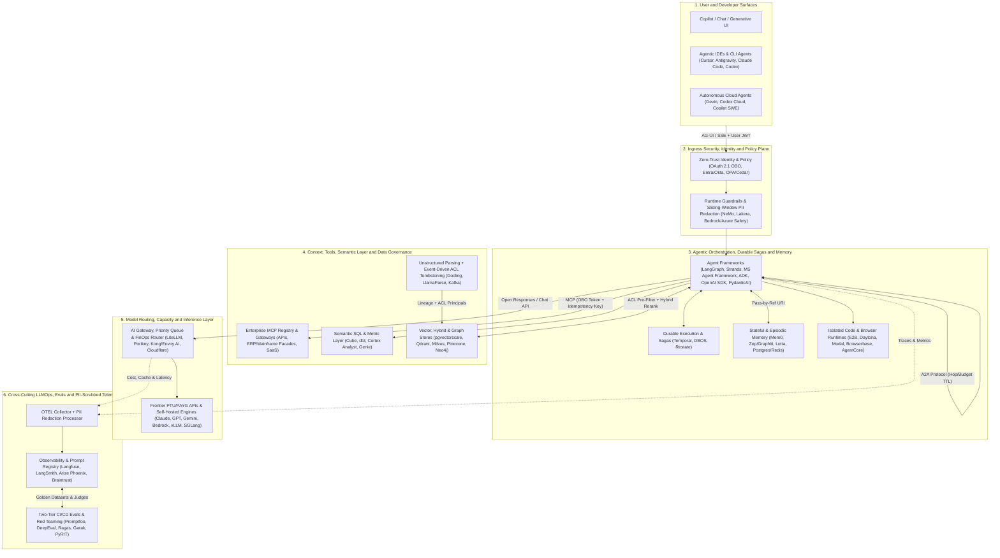
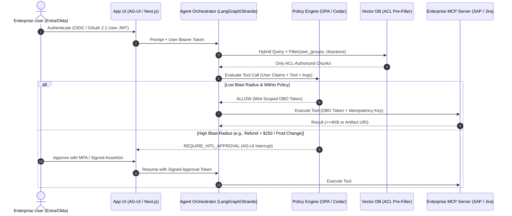
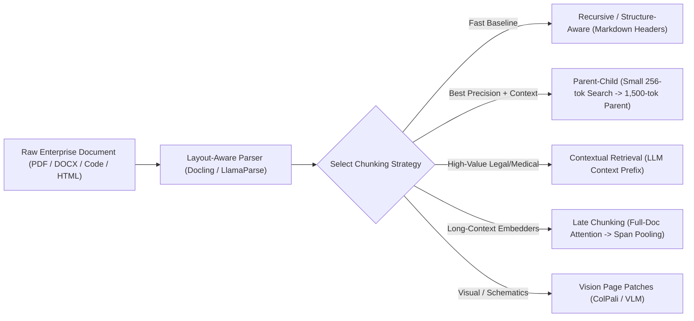
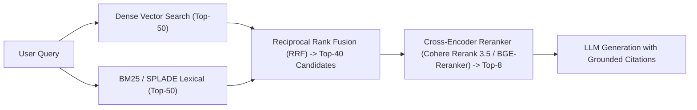
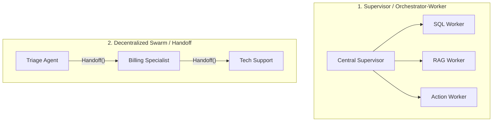

# AI Solution Architect's Complete Ready Reckoner (2026 Edition)

> **Target Audience:** AI Solution Architects, Principal Engineers, & AI Platform Leads  
> **Scope:** Full GenAI & Agentic Stack — Cloud-Agnostic & Open Source First + AWS, Azure, GCP, Databricks & Snowflake  
> **Last Updated:** November 2026

---

## Table of Contents

1. [Enterprise Reference Architecture & Stack Topology](#1-enterprise-reference-architecture--stack-topology)
2. [Layer 1: Protocols, Standards & Boundary Contracts](#2-layer-1-protocols-standards--boundary-contracts)
3. [Layer 2: Foundation Models, LLM Gateways & Inference Serving](#3-layer-2-foundation-models-llm-gateways--inference-serving)
4. [Layer 3: Agentic Orchestration Frameworks & Context Engineering](#4-layer-3-agentic-orchestration-frameworks--context-engineering)
5. [Layer 4: Managed Enterprise Agent Platforms, SaaS Copilots & Low-Code Builders](#5-layer-4-managed-enterprise-agent-platforms-saas-copilots--low-code-builders)
6. [Layer 5: Agent Memory, State Hygiene & Sandboxed Execution Runtimes](#6-layer-5-agent-memory-state-hygiene--sandboxed-execution-runtimes)
7. [Layer 6: Vector Databases, Hybrid Search & GraphRAG Storage](#7-layer-6-vector-databases-hybrid-search--graphrag-storage)
8. [Layer 7: RAG, Unstructured Ingestion, ACL Sync, Semantic SQL & Embeddings](#8-layer-7-rag-unstructured-ingestion-acl-sync-semantic-sql--embeddings)
9. [Layer 8: AI Evaluation, Benchmarking, Reliability Math (`pass^k`) & Quality Gates](#9-layer-8-ai-evaluation-benchmarking-reliability-math-passk--quality-gates)
10. [Layer 9: LLM Observability, Tracing & Prompt Management (LLMOps)](#10-layer-9-llm-observability-tracing--prompt-management-llmops)
11. [Layer 10: Guardrails, Zero-Trust Policy, Structured Outputs & Red-Teaming](#11-layer-10-guardrails-zero-trust-policy-structured-outputs--red-teaming)
12. [Layer 11: AI Coding Assistants, Agentic IDEs & Autonomous SWEs](#12-layer-11-ai-coding-assistants-agentic-ides--autonomous-swes)
13. [Layer 12: Durable Execution, Agentic Sagas & Long-Running Workflows](#13-layer-12-durable-execution-agentic-sagas--long-running-workflows)
14. [Layer 13: Model Optimization, Fine-Tuning, Distillation & GPU Infrastructure](#14-layer-13-model-optimization-fine-tuning-distillation--gpu-infrastructure)
15. [Layer 14: Multimodal AI (Voice/Speech, Vision/Image & Video)](#15-layer-14-multimodal-ai-voicespeech-visionimage--video)
16. [Layer 15: AI Application UX & Frontend SDKs](#16-layer-15-ai-application-ux--frontend-sdks)
17. [Layer 16: Enterprise AI Governance, Compliance, TCO/FinOps & Resilience](#17-layer-16-enterprise-ai-governance-compliance-tcofinops--resilience)
18. [Layer 17: Industry Sector Handbook, Legacy Integration & Constraint-Driven Architectures](#18-layer-17-industry-sector-handbook-legacy-integration--constraint-driven-architectures)
19. [Layer 18: Architect's Scenario-to-Technology Lookup, Reference Stacks & Anti-Patterns](#19-layer-18-architects-scenario-to-technology-lookup-reference-stacks--anti-patterns)

---

## 1. Enterprise Reference Architecture & Stack Topology

Modern GenAI systems have transitioned from monolithic prompt wrappers into **protocol-decoupled, multi-layered agentic architectures**. As a Solution Architect, evaluate every vendor or open-source project by **which boundary contract it fulfills**, **how easily it can be swapped**, and **how much latency/serialization overhead each hop introduces**.



> [!WARNING]
> **Production Engineering Reality Check — Avoid the "Zero-Friction Adapter" Illusion:** Every box and arrow in the diagram above adds **30–400ms of serialization/network/auth overhead**, complicates SSE streaming backpressure, and risks orphan background tasks if a user clicks "Stop Generating" mid-tool-call. Never stack layers you don't need: start with a deterministic workflow + single framework + `pgvector` + AI Gateway, and earn complexity only when metrics demand it.

---

## 2. Layer 1: Protocols, Standards & Boundary Contracts

> [!IMPORTANT]
> **Architect's Takeaway:** Standardize on **protocols** before standardizing on **frameworks**. Frameworks churn every 9–12 months; protocols decouple your tool ecosystem, UI, telemetry, and multi-team agents from framework lock-in.

| Protocol / Spec | Steward / Origin | Boundary Solved | Maturity & License |
| :--- | :--- | :--- | :--- |
| **MCP (Model Context Protocol)** | Anthropic / Open Community | Agent ↔ Tools, Resources, Prompts & Interactive Apps (`MCP Apps`) | Production Standard (MIT / Open Spec) |
| **A2A (Agent2Agent Protocol)** | Linux Foundation (Orig. Google) | Agent ↔ Peer Agent discovery, delegation, stateful task/artifact exchange | Production / Rapid Enterprise Adoption (Apache 2.0) |
| **AG-UI & ACP** | CopilotKit / Open Initiatives | Agent Backend ↔ Frontend UI streaming, HITL interrupts (`AG-UI`); multi-agent REST messaging (`ACP` watchlist) | Growing Standards (MIT / Apache 2.0) |
| **OpenTelemetry GenAI** | CNCF / OpenTelemetry | GenAI Apps/Gateways/Agents ↔ APM & Observability Backends | Enterprise Standard (Apache 2.0) |
| **AGENTS.md & SKILL.md** | Cross-Vendor Open Convention | Codebase / Domain Knowledge ↔ Coding & General Agents | De-facto Standard |
| **Open Responses / Chat Spec** | OpenAI-compatible Ecosystem | Application ↔ Multi-Provider LLM Gateways & Inference Servers | Universal De-facto Standard |

### Deep-Dive Architectural & Production Engineering Notes

#### 1. Model Context Protocol (MCP)
* **Architecture:** Client-Host-Server topology over JSON-RPC 2.0. Transports include `stdio` (local subprocesses for IDEs/desktops) and **Streamable HTTP** (remote enterprise servers with OAuth 2.1 authorization). Exposes three core primitives: **Tools** (model-controlled actions), **Resources** (app-controlled context), and **Prompts** (user-controlled templates), plus **Sampling** and **MCP Apps** (sandboxed HTML UI widgets returned by tools).
* **Pros:** Eliminates $N \times M$ custom connector code; supported natively by Claude, OpenAI, Google ADK, AWS Strands, Microsoft Agent Framework, Cursor, Windsurf, and Antigravity.
* **Production Failure Modes & Enterprise Controls:**
  * *Context Window Bloat (>30 Tools):* Attaching 50+ MCP tools dumps thousands of schema tokens into every turn, degrading tool-selection accuracy and increasing cost. *Mitigation:* Dynamic tool discovery / hierarchical tool routing.
  * *MCP Payload Pagination & Artifact Offloading:* Wrapping a raw REST API as an MCP tool that returns a 250KB JSON list (e.g., 100 Jira issues with full metadata) bloats the context window, spikes TTFT by 8+ seconds, and induces "context rot." *Agent-Ergonomic Tool Design:* Enforce strict response truncation/pagination ($\le 4\text{--}8\text{KB}$ per tool output) and return an `artifact://` URI pointer when the agent needs to inspect large payloads.
  * *MCP Error Opaqueness:* Returning raw `500 Internal Server Error` stack traces causes the LLM to enter pathological retry loops hallucinating parameter permutations. Return **semantic error instructions written for the LLM** (e.g., *"Invalid date format; retry with ISO-8601 YYYY-MM-DD or ask the user to clarify"*).
  * *Streamable HTTP Load-Balancer & Governance Sprawl:* Remote `Streamable HTTP` MCP servers require sticky session awareness/graceful connection draining behind enterprise L7 load balancers (ALB/Envoy). Prevent microservice sprawl by establishing an **Enterprise MCP Registry & Gateway** (version-pinned tool schemas, CI schema-break gates, downstream rate limits, and OAuth 2.1 On-Behalf-Of token scoping).

#### 2. Agent2Agent Protocol (A2A)
* **Architecture:** Complements MCP (MCP = *vertical* agent-to-tool; A2A = *horizontal* agent-to-agent). Uses **Agent Cards** (`/.well-known/agent.json`) to advertise capabilities, authentication schemes, and input/output modalities, and exchanges **Tasks**, **Messages**, and **Artifacts** over HTTP/SSE/JSON-RPC with webhook push notifications for long-running async jobs.
* **When to Use:** Cross-departmental enterprise architectures where Finance builds an agent in Microsoft Agent Framework (Azure), Data builds one in Google ADK (GCP), and DevOps builds one in AWS Strands (Bedrock) — A2A lets a central orchestrator delegate tasks opaque to each agent's internal implementation.
* **When to Avoid:** Inside a single microservice where subagents share in-memory state — use native framework handoffs/subgraphs (e.g., LangGraph subgraphs or Strands Swarms) to avoid serialization and HTTP overhead.
* **Production Safeguards (Cyclic Loops & Cross-Cloud Identity):**
  * *A2A Loop & Budget Headers:* Agent A delegating to Agent B $\rightarrow$ Agent C $\rightarrow$ Agent A creates infinite billing loops. Enforce mandatory `x-agent-hop-budget` (TTL $\le 4$ hops), shared dollar-budget headers, and idempotency keys on every A2A task envelope.
  * *Cross-Domain Identity Propagation:* When delegating across clouds (Azure $\rightarrow$ GCP), assert the originating human user's identity via **Workload Identity Federation + OBO JWT claims** rather than falling back to a shared privileged service principal.

#### 3. AG-UI (Agent-User Interaction Protocol)
* **Architecture:** Event-driven SSE/WebSocket schema defining ~16 standard event types (`TEXT_MESSAGE_CONTENT`, `TOOL_CALL_START`, `STATE_DELTA` via JSON Patch, human-in-the-loop interrupts, generative UI state sync).
* **Architectural Fit:** Prevents building brittle, bespoke WebSocket protocols between Python agent backends (LangGraph, CrewAI, PydanticAI, Strands) and React/Next.js frontends. Ensure client SSE disconnect signals (`AbortSignal`) propagate all the way down to cancel in-flight LLM streams and child subagents.

#### 4. OpenTelemetry (OTEL) GenAI Semantic Conventions
* **Architecture:** Standardizes span attributes (`gen_ai.system`, `gen_ai.request.model`, `gen_ai.usage.input_tokens`, `gen_ai.agent.name`, `gen_ai.tool.name`).
* **Architectural Mandate:** Require OTEL GenAI instrumentation across all internal apps so you can route traces simultaneously to enterprise APM (Datadog, Dynatrace, Grafana Tempo, AWS X-Ray) and specialized LLMOps (Langfuse, Arize Phoenix, LangSmith) without rewriting app code. **Mandatory CISO Control:** Deploy an **OTEL Collector PII/PHI Redaction Processor** inside your VPC to scrub/tokenize sensitive prompt/completion bodies *before* spans are exported to external observability backends.

---

## 3. Layer 2: Foundation Models, LLM Gateways & Inference Serving

### 3.1 Frontier Model Landscape (Architectural Positioning)

| Tier / Family | Key Providers & Families | Primary Architectural Sweet Spot | Trade-offs / Watchouts |
| :--- | :--- | :--- | :--- |
| **Frontier Reasoning & Coding (Proprietary)** | **Anthropic Claude** (Opus / Sonnet / Haiku), **OpenAI** (GPT-5 series / o-series), **Google Gemini** (Pro / Ultra / Flash-Thinking) | Complex multi-step agent planning, deep codebase refactoring, nuanced instruction following, multimodal & 1M+ context synthesis | Highest token cost, external API data residency governance (use Bedrock / Vertex / Azure AI Foundry for enterprise DPAs & private endpoints) |
| **High-Efficiency Workhorses (Proprietary)** | **Gemini Flash / Flash-Lite**, **GPT-mini / nano**, **Claude Haiku**, **Amazon Nova Micro/Lite/Pro** | High-throughput classification, routing, RAG synthesis, voice/realtime low-latency loops, online LLM-as-a-Judge | Weaker on 10+ step unguided reasoning loops; pair with structured workflows |
| **Open-Weight & Enterprise Specialized** | **DeepSeek** (V/R-series), **Alibaba Qwen** (Qwen3 / QwQ / Coder), **Meta Llama**, **Mistral** (Large / Codestral), **OpenAI `gpt-oss`**, **Google Gemma**, **Microsoft Phi**, **NVIDIA Nemotron**, plus enterprise specialists **Cohere Command**, **Writer**, **AI21**, **Moonshot/Kimi**, **MiniMax** | VPC air-gapped sovereignty, custom LoRA/DPO fine-tuning, predictable high-volume unit economics, or domain-tuned enterprise RAG (`Cohere`/`Writer`) | Self-hosting ops burden (KV-cache tuning, GPU autoscaling); DeepSeek/Qwen/Kimi require enterprise legal/origin review in regulated Western sectors |

### 3.2 AI Gateways, Capacity Routing & FinOps Control Planes

> [!TIP]
> **Never let application code call `api.openai.com` or `api.anthropic.com` directly in enterprise production.** Always route through an **AI Gateway** for unified auth, virtual keys, cost attribution, token-aware rate limiting, semantic caching, PII redaction, and multi-region failover.

| Tool | License / Model | Strengths (Pros) | Limitations (Cons) | Best-Fit Scenario |
| :--- | :--- | :--- | :--- | :--- |
| **LiteLLM** | MIT (OSS) + Enterprise | De-facto OSS standard; translates 100+ providers (Bedrock, Vertex, Azure, Ollama, vLLM) into OpenAI format; Python SDK + Proxy Server; virtual keys, budgets, OTEL logging | Proxy is Python/FastAPI — at high streaming concurrency requires async DB logging, Redis pool tuning & horizontal scaling to avoid becoming a SPOF | Default self-hosted AI Gateway & unified SDK for cloud-agnostic engineering teams |
| **Portkey** | Open-core Gateway + Managed SaaS | Sub-millisecond edge overhead; built-in guardrails integration, semantic caching, canary routing, fallback chains, SOC2/HIPAA enterprise governance | Advanced governance, RBAC, and analytics require paid Enterprise tier | Enterprises wanting a turnkey AI control plane with FinOps + Guardrails built in |
| **Kong AI Gateway / Envoy AI Gateway / Azure APIM** | OSS Core + Enterprise / Cloud Native | Extends existing API Gateway infrastructure; Rust/C++/Go performance; centralized mTLS, OAuth, WAF, and non-AI + AI traffic unification | Less developer-centric for prompt engineering or eval workflows compared to Portkey/LiteLLM | Platform teams already running Kong, Envoy/Istio service meshes, or Azure APIM |
| **Bifrost (Maxim) / Helicone / Cloudflare AI GW / Pydantic AI GW** | OSS / Managed Edge | Ultra-low latency Go/Rust/Edge proxies; instant request caching, rate-limiting, and cost analytics | Lighter on complex enterprise IAM/chargeback workflows (except Enterprise tiers) | High-scale SaaS products needing minimal latency overhead at the edge |
| **OpenRouter** | Managed SaaS Marketplace | Single API key for 300+ models across dozens of inference providers with automatic throughput/price routing | SaaS intermediary (data routing policies must be configured per provider for compliance) | Rapid R&D, benchmarking, and developer tooling (Cursor, Cline, Claude Code routing) |

#### Critical Enterprise Gateway & Capacity Patterns
1. **Provisioned Throughput (PTU) vs. Pay-As-You-Go (PAYG) Spillover:** Pure PAYG endpoints on Bedrock, Azure Foundry, and Vertex suffer noisy-neighbor `429 TooManyRequests` throttling during business peaks (where cloud quotas often deduct estimated `max_tokens` upfront from your TPM bucket). Configure **Hybrid Capacity Routing** in your AI Gateway: route baseline traffic to committed **Provisioned Throughput (PTUs)** and automatically spill burst traffic over to PAYG or secondary regional endpoints.
2. **Token-Aware Priority Queuing (Surviving Rate-Limit Storms):** Never let a background batch job or multi-agent loop starve real-time users. Partition traffic at the AI Gateway into **P0 (Interactive User UI)**, **P1 (Async Background Agents)**, and **P2 (Batch Ingestion / Evals)**—shedding or queueing P1/P2 requests when regional TPM utilization crosses 75% so the top 25% of quota is strictly reserved for P0 users.
3. **The Cross-Model Failover Trap:** Failing over a complex 15-tool agent from Claude Sonnet to GPT or Gemini mid-session without prompt/schema adaptation causes silent tool-argument hallucinations because tool pacing, reasoning traces, and prefix-caching economics are tightly coupled to model families. **Rule:** Always fail over across **regions/clouds of the exact same model family first** (e.g., AWS Bedrock `us-east-1` Claude $\rightarrow$ Bedrock `us-west-2` Claude $\rightarrow$ GCP Vertex Claude $\rightarrow$ Anthropic Direct). Only fail over across model families if your CI Golden Dataset runs continuously against both models (or is compiled via `DSPy`).
4. **Data Residency & Cross-Region Inference Gotcha:** AWS Bedrock (`us.` / `eu.` cross-region inference profiles) and Azure Global Standard deployments route requests across regional boundaries for capacity. For strict data sovereignty (GDPR, FINRA, FedRAMP, German/Canadian residency), explicitly lock **Regional Endpoints** in your Terraform/Bicep policies.

### 3.3 Self-Hosted LLM Inference & Serving Engines

* **vLLM (Apache 2.0):** Industry-standard high-throughput serving engine featuring **PagedAttention**, continuous batching, speculative decoding, prefix caching, FP8/AWQ/GPTQ quantization, and OpenAI-compatible server. *Default choice for Kubernetes GPU clusters.*
  * *Production Tuning:* To prevent **KV-Cache Preemption Thrashing** (where long-context bursts exhaust 80GB H100 VRAM blocks and spike P99 TPOT from 18ms to 2,500ms), enable `--enable-chunked-prefill`, quantize the KV cache via `--kv-cache-dtype fp8`, cap `--max-model-len` to actual P99 requirements (e.g., 32k instead of 128k), and use **Multi-LoRA Serving (`--enable-lora`)** to hot-swap 10+ task adapters on a single base model in `<2ms`.
* **SGLang (Apache 2.0):** Excels at **RadixAttention** (automatic KV-cache reuse across multi-turn agent trees and shared few-shot prefixes) and ultra-fast zero-overhead constrained JSON decoding (`xgrammar`). Often outperforms vLLM on complex branching agentic/structured workloads.
* **Prefill / Decode Disaggregation (`NVIDIA Dynamo`, `Mooncake`, `vLLM Disaggregated Serving`):** Separates compute-bound **Prefill nodes** from memory-bandwidth-bound **Decode nodes** over RDMA/NVLink, preventing heavy 64k-token RAG prompts from stalling token generation for concurrent streaming users.
* **NVIDIA TensorRT-LLM, NVIDIA NIM & Triton Inference Server:** Maximum hardware-level throughput and lowest TTFT/TPOT on NVIDIA H100/H200/B200 GPUs via compiled TensorRT engines; **NIM** packages these into enterprise containers; **Triton** & **Ray Serve** orchestrate multi-model ensembles (embeddings + rerankers + vision + LLMs) on shared GPU fleets; **Hugging Face TGI** remains common in HF-centric stacks.
* **Ollama / llama.cpp / LM Studio:** C/C++ GGUF quantization runtimes (`Ollama`, `llama.cpp`) and desktop GUI + local OpenAI-compatible dev server (`LM Studio`) for Apple Silicon, developer laptops, offline demos, and edge devices. *Never use Ollama or LM Studio for high-concurrency multi-user production servers; use vLLM or SGLang instead.*

---

## 4. Layer 3: Agentic Orchestration Frameworks & Context Engineering

The agentic framework space has matured into two distinct architectural camps:
1. **Explicit Graph / Workflow State Machines** (deterministic control, durable checkpointing, time-travel debugging — e.g., *LangGraph, Google ADK Workflows, LlamaIndex Workflows*).
2. **Model-First / Lightweight Autonomous Loops** (minimal scaffolding, trusting frontier model reasoning + native tool calling — e.g., *AWS Strands, OpenAI Agents SDK, PydanticAI, Smolagents*).

### Comprehensive Comparison Matrix

| Framework | Steward & License | Languages | Architectural Paradigm | Native MCP / A2A / OTEL | Ideal Enterprise Fit |
| :--- | :--- | :--- | :--- | :--- | :--- |
| **LangGraph** | LangChain Inc. (MIT; Platform is Commercial) | Python, TypeScript | Stateful cyclical graphs, durable checkpointers, HITL interrupts | MCP (Adapter), A2A (Supported), LangSmith + OTEL | Complex, stateful, long-running workflows needing strict control & human approvals |
| **AWS Strands Agents** | AWS (Apache 2.0) | Python, TypeScript | Model-first autonomous loop (`Model + Tools + Prompt`), Swarms & Graphs | **First-class MCP, A2A, & Native OTEL** | AWS-centric & cloud-agnostic teams wanting minimal boilerplate + Bedrock AgentCore scale |
| **Microsoft Agent Framework (MAF)** | Microsoft (MIT, 1.0 GA 2026) | **Python & .NET** (1:1 parity) | Unifies **Semantic Kernel** (enterprise middleware) + **AutoGen** (multi-agent graphs) | **First-class MCP, A2A, & Native OTEL** | Enterprise .NET & Python shops on Azure AI Foundry / Microsoft Entra |
| **Google ADK** | Google (Apache 2.0) | **Python, TS, Go, Java** | Code-first modular hierarchy (`Sequential`, `Parallel`, `Loop`, LLM Router) | **First-class MCP, A2A**, Built-in Eval CLI + OTEL | Polyglot enterprises (esp. Java/Go/Python) & Vertex AI Agent Engine deployments |
| **OpenAI Agents SDK** | OpenAI (MIT) | Python, TypeScript | Ultra-minimalist (`Agent`, `Runner`, `Handoffs`, `Guardrails`) | Native MCP, Built-in Tracing | Fast iteration, voice/realtime agents, teams wanting plain Python over heavy abstractions |
| **CrewAI** | CrewAI Inc. (MIT + Enterprise AMP) | Python | Role-based collaborative **Crews** + deterministic event **Flows** | MCP Supported, OTEL / CrewAI AMP | Business process automation mapped naturally to human persona teams (Researcher, Analyst, Writer) |
| **PydanticAI** | Pydantic Team (MIT) | Python | Type-safe, FastAPI-like dependency injection, strict schema validation | Native MCP, **Pydantic Logfire (OTEL)** | Production Python backend engineers prioritizing static typing, testability, and clean code |
| **LlamaIndex Workflows & Haystack (deepset)** | LlamaIndex (MIT) / deepset (Apache 2.0) | Python, TypeScript (`LlamaIndex`) | Event-driven async steps (`LlamaIndex`) & explicit modular DAG pipelines (`Haystack`) | MCP Supported, Arize/OTEL | Data-heavy document agents, explicit low-magic RAG pipelines (`Haystack`), and multi-source synthesis |
| **Smolagents** | Hugging Face (Apache 2.0) | Python | **Code-first actions** (`CodeAgent` emits Python code instead of JSON tool calls) | MCP Supported, OTEL | Compositional logic/data tasks where 10 lines of Python replace 8 sequential JSON tool calls (~1,000 LOC library) |
| **Mastra** | Mastra (Apache 2.0) | **TypeScript-only** | Modern TS stack: Workflows, Agents, RAG, Evals for Next.js/Node/Serverless | Native MCP & OTEL | Full-stack TypeScript/React engineering teams building AI-native web products |
| **DSPy** | Stanford NLP (MIT) | Python | **Declarative self-optimizing compiler** (Signatures, Modules, Teleprompters/MIPROv2) | Integrates via wrappers, MLflow tracing | Optimizing compound AI pipelines mathematically against eval metrics when switching models |

### Deep-Dive Pros, Cons & Production Engineering Notes

#### 1. LangChain & LangGraph
* **Important Distinction:** Treat **LangChain** as a standard library of model/tool/retriever integrations, and **LangGraph** as your actual runtime orchestrator. Do not build new agents on legacy LangChain `AgentExecutor`.
* **Pros:** Unmatched ecosystem breadth; **Checkpointers** (Postgres/Redis) provide out-of-the-box persistence, fault recovery, human-in-the-loop pause/resume (`interrupt()`), and "time-travel" state replay; **Deep Agents** pattern supports planning + subagent delegation.
* **Cons & Production Watchouts:**
  * *Pass-by-Reference State vs. Checkpointer Bloat:* Never store raw document chunks, base64 images, or full 100KB tool outputs inside LangGraph `TypedDict` state—by turn 15, Postgres serializes/deserializes 15MB of JSON on every node step (+400ms DB I/O). Use **Pass-by-Reference State** (write bulky payloads to S3/Redis and store only `artifact://` URI pointers + compact summaries in graph state).
  * *In-Flight State Schema Evolution:* Deploying v1.1 code that renames a graph node or modifies `TypedDict` fields while 5,000 HITL threads are paused in Postgres causes deserialization crashes. Version your graph state schemas (`schema_version: int`) and write explicit migration upcasters.

#### 2. AWS Strands Agents SDK
* **Architecture:** Born from internal AWS production agents (Amazon Q Developer, AWS Glue). Strips away rigid workflow DAGs in favor of a **model-driven loop** (`Observe → Reason → Plan → Act → Reflect`), while still providing optional multi-agent primitives (**Agents-as-Tools**, **Swarms**, **Workflows**, and **A2A**).
* **Pros:** Extremely clean Python `@tool` ergonomics; model-agnostic (Bedrock, Anthropic, OpenAI, Gemini, LiteLLM, Ollama); native OpenTelemetry spans out of the box; deploys seamlessly to AWS Lambda, ECS/Fargate, or **Amazon Bedrock AgentCore**.
* **Cons:** Younger community plugin ecosystem than LangChain (though native MCP largely neutralizes this gap); relies heavily on strong tool-calling frontier models.

#### 3. Microsoft Agent Framework (MAF) — *Replacing standalone Semantic Kernel & AutoGen*
* **Architecture:** Reached **1.0 GA in April 2026**, merging **Semantic Kernel's** enterprise plumbing (DI, filters/middleware, telemetry, Entra auth) with **AutoGen's** dynamic multi-agent group-chat and graph workflows. *(Note: Classic AutoGen spun off an independent OSS community fork called **AG2**, while Microsoft's active investment is in MAF).*
* **Pros:** Undisputed #1 choice for **.NET / C#** and mixed C#/Python enterprises; native MCP + A2A; enterprise-grade governance and thread state integration with Azure AI Foundry.
* **Cons:** Heavier enterprise ceremony/boilerplate for quick Python prototypes compared to OpenAI Agents SDK or Strands.

#### 4. Google Agent Development Kit (ADK)
* **Architecture:** Bridges deterministic software engineering (`SequentialAgent`, `ParallelAgent`, `LoopAgent`) with LLM-driven dynamic delegation. Includes a built-in local web UI (`adk web`) and CLI evaluation runner (`adk eval`).
* **Pros:** True **polyglot support (Python, TypeScript, Go, Java)** — huge win for Java/Spring and Go backend enterprises; zero-friction deployment to **Vertex AI Agent Engine** or Cloud Run; native multimodal bidirectional streaming (audio/video via Gemini Live).
* **Cons:** Best ergonomics shine brightest inside GCP (Vertex Search, Apigee, BigQuery), though LiteLLM makes it model-agnostic.

#### 5. PydanticAI & OpenAI Agents SDK (The Minimalist Favorites)
* **When to pick PydanticAI:** Your Python backend already standardizes on **FastAPI + Pydantic**. Dependency injection (`RunContext[Deps]`) makes unit-testing tools with mocked DB/HTTP clients trivial without framework magic.
* **When to pick OpenAI Agents SDK:** Successor to OpenAI Swarm. Four primitives (`Agent`, `Runner`, `Handoff`, `Guardrail`). Ideal when you want readable standard `asyncio` Python and minimal framework lock-in.

### 3.1 Context Engineering & State Hygiene Playbook (Managing the LLM's RAM)
Advertising "1M–2M token context windows" tricks teams into dumping 300k tokens of raw docs and 40 turns of failed tool outputs into the prompt. Above **32k–64k tokens**, instruction adherence on multi-constraint rules drops sharply ("context rot" / attention dilution), prefill latency scales quadratically, and token bills explode. Enforce these four rules:
1. **Prompt Prefix Immutability Rule (>70% KV Cache Hit Rate):** Never inject dynamic timestamps (`Current time: 2026-11-15 14:03:22`), random request UUIDs, or per-turn RAG chunks at the *top* of the system prompt—doing so invalidates 100% of the provider's KV Prefix Cache on every turn. Keep `System Instructions + Tool Schemas + Few-Shot Examples` 100% byte-for-byte static at the prefix; append dynamic user state, timestamps, and RAG context strictly at the tail of the message list.
2. **Tool Output Pruning & Pointer Pattern:** Never retain bulky raw JSON tool outputs from Turn $N-3$ in the message history at Turn $N$. Replace historical tool payloads with a 2-line summary + an artifact URI (`[Full 48KB payload stored at artifact://run_981/tool_4 — call read_artifact() if needed]`).
3. **Failed Trajectory Surgery:** When a tool call fails due to a transient timeout or schema typo and succeeds on retry, **strip the failed attempt and error stack trace from subsequent conversation history** so the model does not self-condition on its own prior errors.
4. **Sub-Agent Context Isolation & Cancellation Propagation:** When an agent needs to inspect 15 files or run 5 broad searches, spawn a stateless sub-agent with a fresh context window to burn 40k tokens and return only a 500-token synthesized finding to the parent orchestrator. Always wire structured cancellation (`asyncio.TaskGroup` / `AbortController`) so UI disconnects immediately abort child subagents.

---

## 5. Layer 4: Managed Enterprise Agent Platforms, SaaS Copilots & Low-Code Builders

### 4.1 Hyperscaler & Data-Platform Managed Agent Runtimes

As agents move from PoC to enterprise production, **infrastructure plumbing**—isolated microVM code execution, per-user OAuth token vaults, long-lived session memory, and IAM identity—becomes harder than writing the agent loop itself. Hyperscalers now offer **framework-agnostic managed runtimes**:

| Managed Platform | Cloud / Data Vendor | Core Value Proposition | Framework Lock-in? | Architectural Best Fit |
| :--- | :--- | :--- | :--- | :--- |
| **Amazon Bedrock AgentCore** | AWS | Modular enterprise runtime: Serverless **MicroVM Session Isolation** (up to multi-hour runs), **AgentCore Memory**, **Identity** (OAuth/IAM), **Gateway** (turns APIs/Lambdas into MCP servers), Browser & Code Interpreter | **No** — hosts Strands, LangGraph, CrewAI, LlamaIndex, or custom containers | Running untrusted/stateful enterprise agents securely at scale on AWS |
| **Azure AI Foundry Agent Service** | Microsoft Azure | Unified managed runtime + Foundry Models, Entra Agent ID, SharePoint/Fabric/Bing grounding, Azure Logic Apps & Functions triggers, Copilot Studio handoff | Low — first-class **Microsoft Agent Framework**, supports LangGraph/OSS | Enterprises standardized on M365, Entra ID, Azure OpenAI, and Power Platform / Copilot Studio |
| **Vertex AI Agent Engine & Agentspace** | Google Cloud | Managed serverless deployment (`adk deploy`), session & memory bank, Cloud IAM, enterprise evaluation suite; **Agentspace** provides employee-facing multimodal search + agent hub | **No** — optimized for **Google ADK**, natively hosts LangGraph, CrewAI, LlamaIndex | GCP enterprises & organizations wanting unified enterprise search + custom engineering agents |
| **Databricks Mosaic AI Agent Framework** | Databricks | Tightly coupled with **Unity Catalog** (row/column ACLs inherited by tools & vector indexes), **MLflow 3 Tracing/Evaluation**, AI Gateway, and Genie (Text-to-SQL) | Low — wraps LangGraph, LlamaIndex, Strands, DSPy, or custom Python | Data-intensive enterprises whose crown-jewel structured/unstructured data lives in Lakehouse / Unity Catalog |
| **Snowflake Cortex Agents** | Snowflake | Orchestrates across **Cortex Analyst** (semantic-model Text-to-SQL) + **Cortex Search** (hybrid RAG) strictly inside Snowflake RBAC & governance perimeter | Medium-High (Snowflake perimeter-centric, though REST/MCP accessible) | Analytics & BI-heavy organizations wanting zero data movement outside Snowflake |

### 4.2 The "Buy vs. Partner vs. Build" Decision Matrix (Core vs. Context)

> [!IMPORTANT]
> **C-Suite & ARB Reality:** One of the costliest mistakes in enterprise IT is custom-building a LangGraph/Strands agent on top of Salesforce, ServiceNow, Workday, or M365 when the organization already owns embedded SaaS Copilot licenses. Build custom agents **only** for cross-system workflows and proprietary domain moats; federate with native SaaS copilots via **A2A** and **MCP**.

| Dimension | **1. BUY (Embedded SaaS Copilots)**<br>*M365 Copilot, Salesforce Agentforce, ServiceNow Now Assist, Workday Illuminate, SAP Joule* | **2. PARTNER / CONFIGURE (Horizontal AI Platforms)**<br>*Glean, Moveworks, Sierra, Writer, Harvey, Kore.ai* | **3. BUILD (Custom Agentic Stack)**<br>*LangGraph / Strands / MAF / ADK + MCP + Custom RAG* |
| :--- | :--- | :--- | :--- |
| **Strategic Differentiation** | Commodity single-SaaS productivity (meeting notes, CRM case summaries, standard HR/IT catalog requests) | Cross-enterprise employee search, horizontal IT/HR service desk, standard omnichannel customer support | **Core IP & competitive moat** (proprietary underwriting, algorithmic pricing, clinical triage, factory OT, R&D) |
| **System & Data Span** | Lives $\ge 85\%$ inside a single SaaS system of record and its native RBAC model | Connects 20–50 standard enterprise SaaS connectors out of the box with pre-built ACL sync | Spans bespoke internal microservices, legacy mainframes/ERPs, proprietary data lakes, and custom domain schemas |
| **Time-to-Value vs. TCO** | Days to weeks; predictable per-seat (\$30–\$60/user/mo) or conversation-pack licensing | 3–8 weeks; platform subscription + consumption tier | 2–6 months; highest upfront engineering OpEx, lowest long-term unit cost & zero vendor lock-in at scale |

### 4.3 Visual, Low-Code & Hybrid Workflow Builders

* **Dify (Open-Source w/ Commercial Cloud/Enterprise License):** Full-stack LLMOps + visual agent/RAG workflow studio with built-in BaaS APIs, RAG ingestion, SSO, and MCP support. *Best for:* Internal AI CoE platforms enabling product managers and engineers to co-build apps self-hosted in VPC. *Watchout:* Multi-tenant enterprise distribution requires a commercial license.
* **n8n (Fair-Code Sustainable Use License):** Deterministic automation juggernaut (400+ SaaS connectors, webhooks, cron triggers) fused with LangChain-backed AI Agent nodes and MCP client/server triggers. *Best for:* Back-office operational automation where **90% is deterministic API/webhook plumbing and 10% is LLM reasoning**.
* **Langflow (MIT, backed by DataStax/IBM) & Flowise (Apache 2.0, acquired by Workday):** Visual drag-and-drop canvas builders for rapid RAG/agent prototyping, exporting clean JSON/API endpoints. *Best for:* Rapid PoCs, visual experimentation, and workshop enablement. *Engineering Watchout:* Visual canvas builders turn into unmaintainable "JSON/YAML spaghetti" once you require Git merge conflict resolution, mocked unit tests in CI, or custom saga rollback logic—graduate complex core products to code-first frameworks.

---

## 6. Layer 5: Agent Memory, State Hygiene & Sandboxed Execution Runtimes

### 5.1 Agent Memory Taxonomy & Tooling

Architects must separate **Short-Term Thread State** (checkpointers like Redis/Postgres storing conversation turns) from **Long-Term Cross-Session Memory** (semantic facts, user preferences, episodic history, and procedural rules).

| Tool | License | Memory Architecture | Pros | Cons / Watchouts |
| :--- | :--- | :--- | :--- | :--- |
| **Mem0** | Apache 2.0 + Managed Cloud | Hybrid Vector + Key-Value + Graph extraction layer; extracts/updates/invalidates atomic user/entity facts asynchronously | Drop-in SDK (`memory.add`, `memory.search`); cuts token costs by retrieving concise facts instead of full chat logs | Extra LLM extraction calls on write path add latency/cost unless run asynchronously in background |
| **Zep / Graphiti** | Apache 2.0 (`Graphiti` engine) + Zep Cloud | **Bi-temporal Knowledge Graph** — tracks *when* a fact became true and *when* it was invalidated (`t_valid`, `t_invalid`) | Solves the hardest enterprise memory bug: **contradictory changing facts over time** (e.g., customer changed tier or address) | Graph DB operational footprint (Neo4j / FalkorDB) required when self-hosting `Graphiti` |
| **Letta (formerly MemGPT)** | Apache 2.0 + Letta Cloud | **OS-inspired Virtual Context Management** — agent actively edits its own Core Memory (in-context RAM) and Archival/Recall Memory (disk) via tool calls | Stateful "always-on" agents that evolve over months without hitting context degradation | Paradigm shift: Letta *is* the stateful agent server rather than a passive library bolted onto another loop |
| **LangMem / Cognee** | MIT / Apache 2.0 | `LangMem` integrates natively into LangGraph state stores (semantic/episodic/procedural); `Cognee` builds modular ECL (Extract-Cognify-Load) AI memory graphs | `LangMem` needs zero extra infra if already running LangGraph Postgres Store | Tighter coupling to Python/LangGraph (`LangMem`) or heavier graph pipelines (`Cognee`) |

#### Production Memory Governance & Failure Prevention
1. **Preventing the Hallucination Amplification Loop:** If a user asks a hypothetical question (*"What if I lived in Texas for tax purposes?"*) and `Mem0`/`Letta` extracts the atomic fact `User lives in Texas`, that false memory is injected into future system prompts as ground truth, permanently corrupting the user's profile. **Mitigation:** Require **Memory Provenance & Confidence Tagging**—every stored fact must link to `source_message_id`, carry a TTL, and distinguish `explicit_user_statement` from `inferred_hypothesis`.
2. **Preventing Cross-Role Memory Contamination:** Never allow an agent to promote a "procedural rule" learned from one user session into global organizational memory without an explicit human curation gate—otherwise one user's mistake or prompt injection poisons all users.
3. **GDPR / CCPA "Right to be Forgotten" in Memory Graphs:** Deleting raw chat logs is insufficient when user PII has been distilled into `Zep`/`Graphiti` graph edges or `Mem0` vectors. Enforce strict `tenant_id` + `user_id` partition keys and test cascading deletion APIs across both vector and graph stores.

### 5.2 Code Execution, Browser & Web Ingestion Sandboxes

> [!CAUTION]
> **Security Rule #1 for Tool-Using Agents:** Never execute LLM-generated Python, Bash, or SQL inside your application container (`exec()` / `subprocess`). Always isolate untrusted code and headless browsers inside ephemeral microVMs or gVisor/Firecracker sandboxes with egress network policies.

* **E2B (Apache 2.0 Core + Cloud):** Sub-200ms boot **Firecracker microVMs** built specifically for AI code interpreters, data analysis agents, and computer-use sandboxes. Industry favorite for custom coding/analyst agents. *Production Rule:* **Pre-bake all Python/apt packages (`pandas`, `scipy`, `matplotlib`) into custom E2B template snapshots**—if the agent runs `pip install` at runtime, latency spikes by 25+ seconds or fails entirely in zero-egress enterprise VPCs.
* **Daytona (OSS + Cloud):** Ultra-fast (<90ms) secure stateful/ephemeral dev workspace containers & sandboxes tailored for AI coding agents needing full git repo + runtime environments.
* **Modal / Fly Machines / Cloudflare Containers:** Serverless Python/container cloud primitives with sub-second cold starts, GPU attachment (`Modal`), and massive horizontal burst for batch evals or sandboxed code execution.
* **Browserbase + Stagehand & `browser-use`:** Managed headless Chromium grid (`Browserbase`, stealth, session replay, residential proxies) paired with **Stagehand** (MIT SDK combining deterministic Playwright with resilient natural-language `act()`, `extract()`, `observe()`) or **`browser-use`** (popular OSS Python computer-use/DOM agent library over Playwright/Puppeteer). *Architectural rule:* Always prefer API/MCP tools over GUI/computer-use automation when an API exists.
* **Firecrawl (AGPL/Cloud) & Crawl4AI (Apache 2.0):** Convert messy, JS-heavy websites into clean, LLM-ready Markdown or structured JSON schemas for RAG and web-research agents.

---

## 7. Layer 6: Vector Databases, Hybrid Search & GraphRAG Storage

> [!NOTE]
> **2026 Architectural Consensus on Vector DBs:** If your corpus is **under 10–20 million vectors** and you already run PostgreSQL, **start with `pgvector` + `pgvectorscale` (or ParadeDB for BM25)**. Introduce a dedicated vector database only when you need billion-scale sharding, multi-tenant namespace isolation at massive QPS, sub-10ms tail latency, or decoupled object-storage economics.

| Database | License / Deployment | Indexing & Search Capabilities | Key Strengths | Trade-offs / When to Avoid |
| :--- | :--- | :--- | :--- | :--- |
| **PostgreSQL (`pgvector` + `pgvectorscale` / `ParadeDB`)** | PostgreSQL / Open Source (Managed on RDS, Cloud SQL, Neon, Supabase) | HNSW + **StreamingDiskANN** (`pgvectorscale`) + BM25 (`pg_search`) + ACID SQL joins | Zero new infrastructure; transactional consistency with relational metadata & RBAC ACLs; high cost-efficiency | At 100M+ high-dimensional vectors with heavy write churn, vacuuming/memory tuning stresses primary OLTP DBs |
| **Qdrant** | Apache 2.0 (Rust) + Qdrant Cloud | HNSW, Sparse Vectors (SPLADE/BM25), Multivector (ColBERT), Scalar/Binary/Product Quantization, **Payload-aware HNSW filtering** | Exceptional Rust performance & memory efficiency; best-in-class filtered vector search & multi-tenancy | Smaller ecosystem of built-in server-side auto-embedding plugins than Weaviate (by design — clean engine focus) |
| **Milvus / Zilliz Cloud** | Apache 2.0 (Go/C++) + Zilliz Managed | HNSW, IVF, DiskANN, GPU CAGRA, Sparse+Dense Hybrid, Multi-vector | Cloud-native disaggregated storage/compute built for **hundreds of millions to tens of billions** of vectors | Distributed Milvus (etcd, Pulsar/Kafka, MinIO, Query/Data/Index nodes) is operationally heavy to self-host for small workloads (use Milvus Lite or Qdrant instead) |
| **Pinecone** | Proprietary Serverless SaaS (BYOC available) | Proprietary Serverless architecture (object-storage backed + geometric indexing), Sparse-Dense Hybrid, integrated reranking | True zero-ops serverless; scales to zero/billions seamlessly; predictable namespace isolation per tenant | Proprietary lock-in (no OSS self-hosted community edition); read/write unit pricing requires monitoring at high QPS |
| **Weaviate** | BSD-3-Clause (Go) + Weaviate Cloud | HNSW, Dynamic/Flat indexes (fast multi-tenant cold storage), native BM25 + Vector Hybrid, GraphQL/gRPC | Rich built-in vectorizer/reranker modules, compression, and rapid developer velocity | Historically higher RAM consumption unless quantization (BQ/PQ) and dynamic offload are configured |
| **LanceDB** | Apache 2.0 (Rust) + LanceDB Cloud | **Lance columnar format** directly on S3/GCS/ADLS; Disk-based IVF-PQ/HNSW + Full-Text + Multimodal (images/video/audio bytes stored alongside vectors) | Serverless embedded library (like DuckDB/SQLite for vectors + multimodal AI data); 10x–100x cheaper storage on S3 | Disk/object-storage cold queries have higher p99 latency (~20–80ms) than pure in-RAM HNSW (~2–5ms) without warm cache |
| **Turbopuffer** | Proprietary Serverless SaaS | Object-storage (S3/GCS) native vector + BM25 search with NVMe/RAM caching | Powers massive multi-tenant coding & AI workloads (e.g., Cursor-scale codebase indexing) at a fraction of RAM-based DB cost | Cold-namespace first-query latency (~100–300ms) before warming into cache; SaaS-only |
| **Chroma** | Apache 2.0 (Python/Rust rewrite) + Chroma Cloud | HNSW + Full-text/Metadata; single-node embedded or distributed Rust-core cloud | Simplest local developer experience (`pip install chromadb`) for PoCs, notebooks, and small apps | Historically focused on dev/small-medium scale; validate distributed scale benchmarks vs. Qdrant/Milvus for massive enterprise clusters |
| **Vespa** | Apache 2.0 + Vespa Cloud | Real-time tensor computation, HNSW, lexical BM25, custom multi-phase ML ranking | Unrivaled when search + recommendation + multi-vector ColBERT + custom ONNX/XGBoost re-ranking must run inside the DB | Steepest learning curve and operational complexity in the category |
| **OpenSearch / Elasticsearch / Redis / MongoDB Atlas** | OSS / Source-Available + Managed Cloud | Hybrid BM25 + HNSW vector + aggregations (`OpenSearch` / `Elastic`); sub-ms cache + vector memory (`Redis`); operational JSON + vectors (`MongoDB`) | **Reuse existing enterprise data platforms** without standing up net-new DB vendors; OpenSearch integrates deeply with AWS Bedrock Knowledge Bases | Less specialized in ultra-compressed disk/S3 vector formats than Qdrant/LanceDB |
| **Neo4j / Amazon Neptune / FalkorDB / ArangoDB** | GPLv3/EE (`Neo4j`), AWS Managed (`Neptune`), SSPL/Cloud (`FalkorDB`), Multi-model (`ArangoDB`), plus `RDF/SPARQL` | Property Graph (`Cypher`/`Gremlin`) & Semantic Triples + Native Vector Index | Essential backbone for **GraphRAG**, CMDB/incident topology, supply-chain/fraud lineage, and temporal memory | Overkill if queries don't require multi-hop relationship traversal or global corpus summarization |

### 6.1 Scenario-Based Vector & Graph Storage Selector
* **Standard Relational + Vector App (<20M vectors, strict ACID & joins):** Choose **PostgreSQL (`pgvector` + `pgvectorscale`)**.
* **High-QPS Multi-Tenant SaaS with Complex RBAC Metadata Filters:** Choose **Qdrant** (payload-aware HNSW prevents the "Filtered HNSW Recall Cliff" where selective filters matching `<0.5%` of the corpus disconnect standard HNSW graphs; in `pgvector 0.8+`, enable `iterative_scan`).
* **100M–10B+ Vectors with Disaggregated Compute/Storage on K8s:** Choose **Milvus / Zilliz** or **Pinecone Serverless** (zero-ops).
* **Massive Multi-Tenant Codebases or Multimodal Lakes on S3/GCS (Cost-First):** Choose **LanceDB** or **Turbopuffer**.
* **Multi-Hop Dependency Lineage (CMDB, Supply Chain BoM, Fraud Rings):** Choose **Neo4j**, **FalkorDB**, or **Amazon Neptune**.

---

## 8. Layer 7: RAG, Unstructured Ingestion, ACL Sync, Semantic SQL & Embeddings

> [!IMPORTANT]
> **Garbage In, Hallucination Out:** 80% of enterprise RAG failures stem from broken PDF table extraction, naive fixed-size chunking that severs context headers, missing lexical+reranker stages, or stale/unfiltered document permissions—not from the LLM or vector DB.

### 7.1 Document Parsing & Multimodal Layout Extraction

| Tool | License / Type | Strengths | Limitations / Trade-offs | Best-Fit Scenario |
| :--- | :--- | :--- | :--- | :--- |
| **Docling (IBM Research)** | MIT (Open Source) | Top open-source local document parser; specialized vision layout + `TableFormer` models convert complex PDFs, DOCX, PPTX, HTML into structured Markdown/JSON with bounding boxes | Requires local CPU/GPU compute pipeline (easy to containerize on K8s/Ray/Modal) | Default choice for air-gapped VPCs, zero per-page API cost, and high-accuracy table extraction |
| **LlamaParse (LlamaCloud)** | Proprietary API / VPC | Vision-LLM powered agentic parsing; excels at nested financial tables, multi-column scientific PDFs, charts, and embedded diagrams | Per-page API cost; cloud call unless deployed via enterprise VPC offering | Complex financial 10-Ks, insurance tables, and engineering diagrams where accuracy trumps parsing cost |
| **Unstructured.io** | OSS Core + Unstructured Platform | Enterprise ETL connectors (SharePoint, S3, Confluence, Google Drive, Box) + partitioning + chunking + embedding pipelines | OSS `hi_res` local mode can be slow without tuning; enterprise connectors live in paid platform | Turnkey multi-source enterprise connector + ingestion ETL pipelines |
| **Mistral OCR / Reducto / Chunkr** | Commercial APIs (`Chunkr` OSS core) | Ultra-fast multimodal OCR preserving LaTeX math, complex scanned forms, checkboxes, and semantic chunk boundaries | Commercial API dependency; evaluate accuracy on domain-specific scanned docs | High-speed scanned forms, handwritten checkboxes, and STEM/LaTeX documents |
| **Cloud Native Doc AI & Classic OSS OCR** | AWS Textract / Azure Doc Intelligence / GCP Doc AI; **PaddleOCR / Tesseract / Apache Tika** | Cloud Doc AI is pre-covered under existing cloud BAA/HIPAA/FedRAMP agreements; `PaddleOCR` leads multilingual open OCR; `Apache Tika` handles classic broad MIME text extraction | Requires post-processing glue code to reconstruct clean hierarchical Markdown for LLMs | Regulated HIPAA/FedRAMP workloads already inside AWS/Azure/GCP or high-speed multilingual OCR (`PaddleOCR`) |

### 7.2 Chunking, Embeddings, Rerankers & Retrieval Architecture Options

* **Chunking Strategies by Document Type:**
  * **Structure-Aware (Heading/Section) + Parent-Child Retrieval (Default Enterprise Choice):** Search small child chunks (256–400 tokens) for high embedding precision, but pass the larger parent section (1,000–2,000 tokens) to the LLM.
  * **Late Chunking (Jina Pattern):** Pass the full 8k-token document through a long-context embedding model *before* mean-pooling chunk token spans—preserves cross-paragraph pronoun/entity references ("the company", "this dosage") without LLM rewrite costs.
  * **Contextual Retrieval (Anthropic Pattern):** Prepend a 50–100 token LLM-generated document context summary to every chunk before embedding + BM25 indexing. Cuts retrieval failure rates by ~49–67% (*Use when:* high-value policy/legal/medical corpora under 1M chunks; *Avoid when:* 50M+ high-churn chunks without prompt prefix caching due to ingestion token cost).
* **Top Embedding Models:**
  * *Commercial Frontier:* **Voyage AI** (`voyage-3-large`, `voyage-code-3`, `voyage-finance-2`, `voyage-law-2`), **Cohere Embed v4** (multimodal + Matryoshka compression), **OpenAI** (`text-embedding-3-large`), **Google** (`gemini-embedding-001`), **Amazon Titan / Nova Embeddings**.
  * *Open-Weight Self-Hosted:* **BAAI BGE-M3** (simultaneous dense + sparse lexical + multi-vector in one pass!), **Microsoft E5 (`multilingual-e5`)**, **Qwen3-Embedding**, **Alibaba GTE**, **Nomic Embed**, **Jina Embeddings v3/v4**.
* **Cross-Encoder Rerankers (High-ROI Accuracy Boost):**
  * **Cohere Rerank 3.5**, **Voyage Rerank 2**, **Jina Reranker**, **ZeroEntropy (`zerank`)**, **BGE-Reranker-v2-m3 (OSS)**, **ColBERT (late-interaction)**, **FlashRank (ultra-lightweight CPU <15ms)**.
* **Selecting the Right RAG Pattern for Your Scenario:**

| RAG Architecture Pattern | How It Works | When to Use (Target Scenario) | Watchouts & Unit Economics |
| :--- | :--- | :--- | :--- |
| **1. Two-Stage Hybrid RAG** | Query Rewrite/HyDE → Parallel Dense + BM25 (`RRF` top-50) → ACL Pre-Filter → Cross-Encoder Rerank (top-8) | **85% of enterprise RAG use cases** (policies, SOPs, support tickets, technical docs) | Always include BM25 for exact part numbers, SKUs, error codes, and acronyms |
| **2. Agentic / Corrective RAG (`CRAG` / `Self-RAG`)** | Agent grades retrieved chunks, rewrites failed queries, and routes dynamically across vector, web, or API tools | Complex multi-part research questions spanning heterogeneous sources | Multiplies latency and token cost by 2x–4x; bound max retries to $\le 2$ |
| **3. GraphRAG / LightRAG / RAPTOR** | Extracts entity-relationship graphs (`Microsoft GraphRAG`, `LightRAG`) or hierarchical summary trees (`RAPTOR`) | Global sensemaking across whole corpora (*"What are the top recurring risk themes across 5,000 audit reports?"*) | Full `GraphRAG` indexing is token-expensive and slow on incremental deletes; prefer **LightRAG** or **RAPTOR** for lower cost |
| **4. Vision-First Multimodal RAG (`ColPali` / `ColQwen2`)** | Embeds page screenshots directly as patch-level multi-vectors using VLMs—skipping text OCR entirely | Visual-heavy PDFs: engineering schematics, P&ID diagrams, slide decks, retail catalogs | Generates ~1,030 vectors *per page*; require **binary quantization + hierarchical token pooling (MUVERA)** to avoid RAM explosion |

### 7.3 Permission-Aware RAG, Data Lineage & Incremental ACL Sync
In enterprise deployments (SharePoint, Confluence, Google Drive, Salesforce), **you cannot dump documents into a vector DB without access controls**:
1. **Permission Enforcement Options:**
   * *Option A: Metadata ACL Pre-Filtering (Simple/Fast):* Stamp `allowed_groups`, `allowed_users`, and `sensitivity_label` onto every chunk payload (`Qdrant`, `pgvector`, `Azure AI Search`, `Unity Catalog`).
   * *Option B: Fine-Grained Zanzibar / ReBAC Graph (Complex Hierarchies):* Intersect retrieval candidates with **SpiceDB, OpenFGA, Okta FGA, or Microsoft Graph** when permissions inherit across deep folder/org trees.
2. **Event-Driven Tombstoning & Lineage:** Hook source webhooks (`SharePoint`/`S3`/`Confluence`) into **Kafka / AWS EventBridge / Debezium CDC** so document deletions, version updates (`v2` replacing `v1`), and permission revocations purge or update vector chunks within a strict SLA (`<5 minutes`).
3. **Zero-Downtime Embedding Upgrades (Blue/Green Aliasing):** Never mix different embedding models in the same index. Query vector collections through an alias (`kb_prod_current → kb_v2_voyage3`) so background re-indexing swaps atomically.

### 7.4 Structured Data, Text-to-SQL & Enterprise Semantic Layers
> [!WARNING]
> **Never point raw LLM Text-to-SQL directly at 500+ raw ERP/OLTP tables** (where cryptic columns like `FLG_X1` or `T_ORD_99` cause 70%+ query failure or silent metric miscalculation).

| Option / Tool | Category | Best-Fit Scenario |
| :--- | :--- | :--- |
| **Snowflake Cortex Analyst / Databricks AI/BI Genie** | Data-Platform Native Semantic Text-to-SQL | Organizations standardized on Snowflake or Databricks Lakehouse wanting governed natural-language analytics |
| **Cube / dbt Semantic Layer / LookML** | Headless Enterprise Metric Stores | Enforcing a single definition of "Net Revenue" or "Active Churn" across BI dashboards *and* AI agents via MCP |
| **WrenAI / Vanna.ai / Custom Two-Tier Schema Linker + `sqlglot`** | Open-Source / Custom Text-to-SQL Engines | Self-hosted or legacy databases: index verified golden SQL pairs + table metadata in vector search, retrieve top-5 tables, and validate generated SQL with **`sqlglot` AST parsing** (enforcing read-only `SELECT`, blocking Cartesian joins, and injecting `tenant_id` + `LIMIT`) |

---

## 9. Layer 8: AI Evaluation, Benchmarking, Reliability Math (`pass^k`) & Quality Gates

> [!TIP]
> **Eval-Driven Development (EDD):** Never approve an enterprise GenAI architecture without two automated feedback loops: **(1) Offline CI/CD Regression Gates** on a curated Golden Dataset before deployment, and **(2) Online Production Sampling Judges** scoring live asynchronous traces.

### Evaluation Frameworks Comparison

| Tool | License | Core Focus | Strengths (Pros) | Limitations (Cons) |
| :--- | :--- | :--- | :--- | :--- |
| **Promptfoo** | MIT (OSS CLI/Web) + Enterprise | Declarative YAML/CLI matrix testing, CI/CD gates & **Automated Red-Teaming** | Zero-SDK lock-in; compares prompts $\times$ models $\times$ providers side-by-side locally in minutes; industry-leading adversarial security scanner | Less Pythonic than `pytest`-native libraries if engineers prefer writing imperative unit tests in Python |
| **DeepEval (Confident AI)** | Apache 2.0 + Confident Cloud | **"Pytest for LLMs & Agents"** — 40+ research-backed metrics (G-Eval, Hallucination, Task Completion, Tool Correctness) | Native `pytest` integration (`deepeval test run`); synthetic dataset generator; strong agent trajectory & multi-turn conversational metrics | LLM-as-a-Judge heavy metrics can become slow/expensive in CI unless run concurrently with fast judge models |
| **Ragas** | Apache 2.0 | **RAG & Agent Evaluation** (`Context Precision`, `Context Recall`, `Faithfulness`, `Answer Relevancy`, `Agent Goal Accuracy`) | Standard mathematical vocabulary for diagnosing *retrieval* vs. *generation* bottlenecks; evolutionary synthetic testset generation | Early versions were brittle with rate limits/custom models (vastly improved in v0.2+, though still primarily RAG-centric) |
| **Inspect AI (UK AISI)** | MIT | Frontier model & autonomous agent safety, coding sandboxes (Docker/K8s), multi-turn tool-use evaluations | Cleanest architecture for evaluating **sandboxed autonomous agents** on complex coding, cyber, and reasoning benchmarks | Geared more toward rigorous capability/safety benchmarking than SaaS product analytics |
| **Braintrust (`autoevals`)** | MIT (`autoevals` lib) + SaaS | High-velocity evals + observability loop (`Eval()` runner in TS/Python, instant diffing of score regressions on PRs) | Best UX for turning a failing production trace into a permanent regression test case in 1 click | Full platform UI/collaboration is commercial SaaS (hybrid data plane available for enterprise) |
| **TruLens & Giskard** | MIT / Apache 2.0 | `TruLens`: **RAG Triad** + Snowflake Cortex integration; `Giskard`: OSS LLM/ML vulnerability, bias, hallucination & RAG test-suite generator | Visual diagnosis of hallucination triangles (`TruLens`) and automated business-facing QA/red-teaming scans (`Giskard`) | Smaller standalone trace-ops platform than LangSmith or Langfuse |

### Architectural Notes on Agent Evaluation & Reliability Math
1. **Final Outcome vs. Trajectory Eval:** Evaluate **(a) Final State/Outcome** (did the sandbox/DB reach the right state?) and **(b) Step Trajectory** (`Tool Call Precision` & `Step Efficiency` without redundant loops).
2. **`pass@k` vs. `pass^k` (Crucial Enterprise Distinction):**
   * **`pass@k`** measures the probability that *at least 1 of $k$ trials succeeds*—ideal for coding assistants where a developer picks the best suggestion.
   * **`pass^k`** ($\text{pass}^k \approx p^k$) measures the probability that the agent succeeds on **all $k$ trials consistently**. An enterprise support agent with $80\%$ single-run accuracy has only $0.80^5 = 32.7\%$ $\text{pass}^5$ consistency! Always gate customer-facing automation on **`pass^3` or `pass^5`**.
3. **Two-Tier CI/CD Eval Gate Architecture (Preventing Slow/Flaky PRs):**
   * *Tier-0 (Every PR Commit, <30 seconds, \$0 cost):* Deterministic unit tests—Pydantic schema validation, regex/keyword checks, `sqlglot` AST checks, and mocked tool trajectories using recorded VCR cassettes.
   * *Tier-1 (Pre-Release / Nightly / Prompt Change):* Full 100-case Golden Dataset scored by calibrated **binary pass/fail LLM Judges** (aligned against human SME labels with Cohen's $\kappa > 0.75$).
4. **Cold-Start Golden Dataset Bootstrap (How to Start on Day 1):** (1) Generate 50 synthetic edge-case & persona queries (`DeepEval`/`Ragas`) verified by 2 domain SMEs → (2) Run in Shadow Mode for 1 week harvesting real user queries → (3) Wire a 1-click "Promote Failed Trace to Golden Dataset" pipeline from `Langfuse`/`LangSmith`/`Braintrust`.

---

## 10. Layer 9: LLM Observability, Tracing & Prompt Management (LLMOps)

| Platform | License & Self-Hosting | OTEL Native? | Standout Architectural Capabilities | Trade-offs / Watchouts |
| :--- | :--- | :--- | :--- | :--- |
| **Langfuse** | **MIT Core** (Docker / K8s Helm self-host) + Cloud/Enterprise | **Yes** (OTEL receiver + SDKs) | Gold-standard **open-source LLMOps**: nested agent trace trees, versioned **Prompt Management** with zero-latency SDK caching, cost tracking, datasets, annotation queues, LLM-as-a-Judge | Enterprise SSO/RBAC/audit logs sit in commercial EE tier; high-volume self-hosting v3 uses ClickHouse + Redis + S3 (solid scale, extra infra components) |
| **LangSmith** | Proprietary SaaS + Self-Hosted (Enterprise K8s) | Yes (OTEL ingest supported + native SDK) | Unbeatable zero-config UX for **LangGraph / LangChain** (works great without LangChain too); interactive Prompt Playground, dataset splits, human review queues, online insights clustering | Self-hosting requires an Enterprise contract; tightest magic favors LangChain ecosystem |
| **Arize Phoenix** | **Apache 2.0 / Elastic** (100% OSS container) + Arize AX | **Built from ground up on OpenInference (OTEL)** | Vendor-neutral OTEL spans across 20+ frameworks; strong **UMAP embedding drift visualization**, span-level retrieval evals, prompt playground & experiments | Multi-team enterprise RBAC and long-term petabyte retention push toward commercial **Arize AX** |
| **Braintrust** | Commercial SaaS + Hybrid VPC Data Plane | Yes | Unifies **offline CI evals + prompt playground + production logging** in a blazingly fast columnar store (`Brainstore`) | Commercial product (generous free tier, paid team scaling) |
| **MLflow Tracing (v3+)** | **Apache 2.0** (Linux Foundation / Databricks) | **Yes** (OTEL compatible) | One-line `mlflow.<framework>.autolog()` across LangGraph, Strands, OpenAI, CrewAI, DSPy; unifies classical MLOps model registry with GenAI traces & judges | Standalone OSS UI is more utilitarian than LangSmith/Braintrust unless paired with managed Databricks Mosaic AI |
| **Weights & Biases Weave / Maxim AI / Patronus / Galileo** | Commercial SaaS + Enterprise VPC | Yes | `Weave`: tight synergy for teams training/fine-tuning models + building agents; `Maxim` & `Galileo`: strong real-time hallucination metrics & multi-agent simulation | Commercial licensing; avoid running multiple overlapping tracing SDKs in the same hot path |
| **Enterprise APM & Dedicated Prompt Registries** | **Datadog LLM Obs**, **Dynatrace**, **New Relic**; **PromptLayer**, **Humanloop** | **Yes** (Native OTEL ingest) | Correlates AI traces directly with Kubernetes, APM, DB, and infrastructure SLOs in one pane of glass (`Dynatrace`/`Datadog`); governance-focused prompt versioning (`PromptLayer`) | Less specialized in prompt playground / synthetic eval generation than LangSmith, Langfuse, or Braintrust |

### 9.1 Observability Privacy & Telemetry Architecture Options
* **In-Flight PII/PHI/PCI Scrubbing (CISO Mandate):** By default, LLMOps spans capture raw user prompts, retrieved chunks, and tool arguments—which can turn your observability platform into an unencrypted repository of customer SSNs, HIPAA PHI, or credentials. Route all spans through an **OpenTelemetry Collector with PII Redaction / Presidio / Regex Processors** inside your VPC *before* exporting to external SaaS, or use **Hybrid Data-Plane / VPC Self-Hosted** deployments (`Langfuse K8s`, `Phoenix`, `Braintrust Hybrid Data Plane`).

---

## 11. Layer 10: Guardrails, Zero-Trust Policy, Structured Outputs & Red-Teaming

### 10.1 Runtime Guardrails & Input/Output Firewalls

* **NVIDIA NeMo Guardrails (Apache 2.0):** Programmable conversational & agentic rails using **Colang**; orchestrates input rails (jailbreak, topic bounds), dialog rails, retrieval rails, and execution rails; supports GPU-accelerated small safety models (`Llama-3.1-Nemotron-Safety-Guard`). *Pros:* Deepest dialog flow control. *Cons:* Learning Colang DSL + added hop latency if running heavy LLM checks synchronously.
* **Guardrails AI (Apache 2.0):** Python/JS runtime wrapper around a **Validator Hub** (PII via Presidio, regex, SQL validation, competitor mentions, toxic language, provenance). *Pros:* Composable validators running in parallel on input/output streams.
* **Lakera Guard (Commercial SaaS / Self-Hosted Container):** Ultra-low-latency (<50ms) specialized security firewall trained continuously on real-world **prompt injection, indirect RAG injection, data exfiltration, and PII leaks**. *Best for:* High-throughput customer-facing apps where LLM-based guardrails add unacceptable TTFT latency.
* **Hyperscaler Native Safety:** **AWS Bedrock Guardrails** (includes **Automated Reasoning Checks**—formal mathematical verification against policy logic to prevent hallucinations!), **Azure AI Content Safety** (Prompt Shields for indirect injection + Groundedness detection), **Google Model Armor** (centralized prompt injection/DLP screening across Vertex AI).
* **Open-Weight Safety & Fast Encoder Classifiers:** **Meta Llama Guard 3/4**, **Prompt Guard**, **Google ShieldGemma**, **Protect AI LLM Guard**, **Microsoft Presidio** (PII), and **GLiNER** (sub-15ms zero-shot NER/PII extraction on CPU/GPU).
* **Solving the Streaming vs. Output Guardrail Trade-Off:** Buffering an entire LLM response before running output guardrails destroys streaming UX, while token-by-token streaming leaks PII before detection. **Pattern:** Use **Chunked Sliding-Window Stream Guardrailing** (buffer 20–40 token clauses and run `<20ms` regex/`Presidio`/`GLiNER`/`Lakera` checks asynchronously on the sliding window).

### 10.2 Deterministic Policy-as-Code & Zero-Trust Agent Identity (OBO)
> [!IMPORTANT]
> **Probabilistic Guardrails $\neq$ Deterministic Authorization:** Never rely on a system prompt or LLM guardrail to enforce business rules like *"Do not issue refunds over \$250."* Enforce authorization deterministically at the MCP / Tool Gateway boundary.

| Security Layer | Leading Technologies & Options | Scenario & Architectural Role |
| :--- | :--- | :--- |
| **Deterministic Policy Engines (Policy-as-Code)** | **Open Policy Agent (OPA / Rego)**, **AWS Cedar**, **Oso**, **Cerbos** | Intercepts every agent tool call (`tool_name`, `arguments`, `user_claims`) at the MCP Gateway and deterministically blocks or triggers a Human-in-the-Loop interrupt when parameters exceed policy bounds |
| **Fine-Grained Relationship AuthZ (ReBAC)** | **SpiceDB (AuthZed)**, **OpenFGA**, **Okta FGA** | Google Zanzibar-style permission graphs for document-level RAG filtering and multi-tenant resource authorization |
| **Agent Identity & On-Behalf-Of (OBO) Delegation** | **OAuth 2.1 OBO Token Exchange**, **Microsoft Entra Agent ID**, **Bedrock AgentCore Identity**, **SPIFFE / SPIRE** | Eliminates "god-mode" shared service accounts; mints short-lived, least-privilege tokens scoped to the intersection of the **Human User's permissions** and the **Agent's allowed scopes** |



### 10.3 Guaranteed Structured Outputs
* **Native Constrained Decoding (First Choice):** OpenAI Structured Outputs (`response_format` with `strict: true`), Anthropic Tool Use / Strict Schemas, Gemini `response_schema`, and `vLLM`/`SGLang` `xgrammar` / `outlines` backends compile JSON Schemas or CFGs into token masks—guaranteeing 100% syntactically valid JSON with zero retry overhead.
* **Instructor (MIT), Pydantic & Zod:** Lightweight libraries built on **Pydantic** (Python) and **Zod** (TypeScript) that layer **semantic validation + automatic self-correction retries** on top of every major provider.
* **Outlines / Guidance:** Token-level regex, CFG, and JSON schema constrained generation directly inside local/self-hosted model logits.
* **Engineering Best Practices for Structured Schemas:**
  1. *Put Reasoning Before Decisions:* Forcing a model to emit a classification or enum token as the very first JSON key degrades accuracy by 10–25%. Always place a `reasoning_steps: str` or `rationale: str` field **before** the final decision/action fields in your Pydantic schema (or use native reasoning tokens).
  2. *Schema Compilation Warmup:* Deeply nested Pydantic schemas with unions compile into large CFGs that can add 3–10s latency on the first cold request; keep tool/output schemas flat and pre-warm them on deployment.

### 10.4 Automated Red-Teaming, MITRE ATLAS & OWASP Agentic Security
* **Security Taxonomies:** Pair **OWASP GenAI / LLM Top 10** (application & agentic vulnerabilities) with **MITRE ATLAS** (ATT&CK-style adversarial threat matrix covering ML supply chain, model evasion, and reconnaissance).
* **Red-Teaming Toolkits:**
  * **Promptfoo Red Team (MIT/Enterprise):** Generates dynamic multi-turn jailbreaks, BOLA/RBAC bypasses, SSRF, SQLi, and indirect prompt injections tailored to your specific system prompt and tools.
  * **Microsoft PyRIT (MIT):** Python Risk Identification Toolkit for multi-turn adversarial attacker-agent vs. target-agent campaigns.
  * **NVIDIA Garak (Apache 2.0):** "Nmap/Metasploit for LLMs" — automated probe scanner for hallucination, data leakage, encoding bypasses, and package hallucination (`slopsquatting`).
* **Top Architectural Threat Vectors to Mitigate (OWASP LLM & Agentic Top 10):**
  1. **Indirect Prompt Injection:** Untrusted external data (emails, web pages, Jira tickets, PDF resumes) contains hidden instructions that hijack an agent's MCP tools to exfiltrate private data. *Mitigation:* Privilege separation, untrusted-context tagging, HITL confirmation on state-mutating/external-egress tools.
  2. **Excessive Agency & Confused Deputy:** Agents authenticating to databases/APIs with god-mode service credentials instead of **on-behalf-of (OBO) user-scoped tokens**.
  3. **Memory / RAG Poisoning:** Persisting attacker-injected facts into long-term memory (`Mem0`/`Zep`) or shared vector namespaces so future sessions are compromised.

---

## 12. Layer 11: AI Coding Assistants, Agentic IDEs & Autonomous SWEs

As an AI Solution Architect, you will frequently design your organization's **AI-Augmented Software Delivery Lifecycle (AI-SDLC)**. Modern engineering stacks combine **five distinct form factors**:

| Category | Leading Tools | Operating Mode | Strengths & Enterprise Positioning | Watchouts / Governance |
| :--- | :--- | :--- | :--- | :--- |
| **1. Agentic Visual IDEs** | **Cursor**, **Google Antigravity**, **AWS Kiro**, **Windsurf (Cognition)**, **VS Code + GitHub Copilot**, **Amazon Q Developer**, **Cline / Roo Code**, **Zed** | Synchronous + Parallel local IDE workspace | `Cursor`: multi-model routing, Composer multi-file edits, Tab prediction, cloud agents.<br>`Antigravity`: agent-first IDE orchestrating parallel subagents, browser-in-the-loop verification, skills.<br>`Kiro`: AWS's spec-driven agentic IDE turning requirements into design specs & task plans.<br>`GitHub Copilot` & `Amazon Q Developer`: frictionless enterprise procurement, IP indemnity, deep GitHub / AWS IAM integration.<br>`Cline`: model-neutral OSS coding agent extension supporting MCP, local models & custom gateways. | Enforce Zero-Data-Retention (ZDR) / Business tiers; standardize repo context via `AGENTS.md` / `SKILL.md`; vet third-party VS Code extensions on forks |
| **2. Terminal / CLI Coding Agents** | **Claude Code**, **OpenAI Codex CLI**, **Gemini CLI**, **Aider**, **Goose (Block)**, **OpenCode** | Local shell, Unix-composable, headless CI/CD scriptable | `Claude Code`: gold standard for deep architectural reasoning, massive refactors, git workflows, subagents, hooks, and MCP.<br>`Codex CLI`: lightweight Rust/terminal agent powered by OpenAI reasoning models.<br>`Aider` / `Goose`: 100% OSS, BYO-model/AI Gateway (LiteLLM/Bedrock/local). | High token consumption on large repos without `/compact` discipline; enforce granular shell command allowlists & sandbox mode |
| **3. Autonomous Cloud SWEs** | **Devin (Cognition)**, **OpenAI Codex Cloud**, **GitHub Copilot Coding Agent**, **OpenHands (OSS)**, **Factory** | Asynchronous ticket-to-PR inside isolated cloud VMs | Triggered from Slack, Linear, Jira, or GitHub Issues; spins up full sandbox VM, reproduces bugs, runs test suites, and opens reviewed PRs in parallel while engineers sleep. | Fails on poorly specified tickets or undocumented tribal repo rules — **requires strong `AGENTS.md`, fast deterministic CI tests, and well-scoped tasks** |
| **4. AI Code Review & Repo Intelligence** | **CodeRabbit**, **Qodo (PR-Agent)**, **Greptile**, **Bugbot (Cursor)** | Automated PR gatekeeper | Catches logic bugs, security flaws, cross-file regressions, and missing tests before human peer review (`Qodo PR-Agent` offers OSS self-hosting). | Tune noise thresholds carefully so developers don't suffer alert fatigue on stylistic nitpicks |
| **5. Rapid Full-Stack / UI Generators** | **v0 (Vercel)**, **Bolt.new**, **Lovable**, **Replit Agent** | Prompt-to-deployed React/Next.js/Supabase app | Accelerates UX/PM interactive prototyping from weeks to 30 minutes; `v0` produces clean Shadcn/Tailwind components. | Generated code requires architectural review (auth, RLS policies, secret handling) before promoting to enterprise production |

---

## 13. Layer 12: Durable Execution, Agentic Sagas & Long-Running Workflows

> [!IMPORTANT]
> **From Chatbots to Asynchronous Work:** When an enterprise agent runs for 30 minutes or waits 8 hours for a human manager's approval in Slack/Teams, in-memory async loops fail on pod restarts, deploys, or transient API timeouts. Pair your agent framework with a **Durable Execution Engine**.

| Engine | License | Architectural Model | Strengths & Agent Integration | Best-Fit Scenario |
| :--- | :--- | :--- | :--- | :--- |
| **Temporal** | MIT Server + Temporal Cloud | Event-sourced deterministic replay workflows + non-deterministic Activities (LLM/MCP calls) | Industry gold standard for fault-tolerant distributed state; native **PydanticAI** & OpenAI Agents SDK durable integrations | High-scale mission-critical multi-step agent sagas across polyglot microservices |
| **DBOS (DBOS Transact)** | MIT + DBOS Cloud | **PostgreSQL-backed lightweight durable execution** via simple Python/TS decorators (`@DBOS.workflow()`) | Zero extra workflow cluster to operate if you already run Postgres; native PydanticAI & LangGraph synergy | Python/TS teams wanting durable agent checkpoints and queues using only existing PostgreSQL |
| **Restate** | BSL / OSS + Cloud | Rust-built virtual stateful objects & durable RPC/promises for microservices and serverless functions | Ideal for **serverless/Lambda** agents so you don't pay idle compute while waiting on slow LLM or human approvals | Event-driven serverless & AWS Lambda / Cloudflare Worker agent architectures |
| **Inngest & Hatchet** | OSS Core + Managed Cloud | Event-driven durable step functions, concurrency/rate-limit queues, and DAG workflows (`step.run()`, `step.waitForEvent()`) | Developer-friendly TypeScript/Python SDKs built specifically for AI background jobs, fan-out, and per-tenant rate limiting | Full-stack SaaS teams needing zero-ops durable AI background queues and HITL event waits |
| **Prefect / Azure Durable Functions / AWS Step Functions** | Apache 2.0 (`Prefect`) / Cloud Native | Pythonic data/agent flow orchestration (`Prefect` / `ControlFlow`) or cloud-native serverless state machines | Zero new vendor if already running Prefect data pipelines, Azure Functions, or AWS Step Functions | Cloud-native serverless shops or data engineering teams already standardized on Prefect |

### 12.1 Architectural Rules for Durable Agents (Sagas & Idempotency)
1. **Strict Deterministic Envelope Isolation:** In replay engines like `Temporal`, never place LLM calls, `uuid.uuid4()`, `datetime.now()`, or dynamic prompt branching directly inside the Workflow function—always wrap them inside **Activities**, and use workflow versioning (`patched`) so code deploys don't trigger `NonDeterministicWorkflowError` on sleeping threads.
2. **Idempotency Keys on Every Tool Mutation:** If an MCP tool call creates a ServiceNow ticket or charges a card, and the HTTP response times out at 30s, the durable engine will retry the activity. Always pass a deterministic `idempotency_key = hash(workflow_id + step_id + tool_args)` so downstream APIs deduplicate retries.
3. **The Agentic Saga Pattern (Compensating Transactions):** When an agent mutates multiple systems (*Step 1: Reserve Inventory in SAP → Step 2: Charge Stripe → Step 3: Create Shipment*), define explicit **compensating rollback activities** (`release_inventory`, `refund_charge`) in your durable workflow rather than relying on the LLM to figure out how to undo partial failures.

---

## 14. Layer 13: Model Optimization, Fine-Tuning, Distillation & GPU Infrastructure

### 13.1 Decision Guide: Context Engineering vs. Classical ML vs. Distillation vs. Fine-Tuning

| Scenario / Problem to Solve | Recommended Approach & Tooling | Why Not a Heavy Frontier LLM? |
| :--- | :--- | :--- |
| **Missing up-to-date corporate facts, policies, or user data** | **Hybrid RAG + Context Engineering** (`Layer 7`) | Fine-tuning does not reliably memorize dynamic facts and immediately goes stale |
| **Sub-15ms Intent Routing, PII Redaction, or Reranking on the hot path** | **Classical / Encoder SLMs (`ModernBERT`, `DeBERTa-v3`, `GLiNER`, `FlashRank`)** on ONNX Runtime / TensorRT | 100x cheaper and 50x faster (`3–15ms`) than calling a 70B generative LLM |
| **Need frontier quality on a narrow task at 10x lower cost / 5x lower latency** | **Task Distillation** (Frontier Teacher like Claude/GPT labels 5,000 golden traces → SFT/DPO a `Qwen3-8B` / `Llama-3.3-8B` Student) | Slashes unit cost while preserving domain-specific JSON structure and tone |
| **Adapting 10+ specialized domain skills on a modest 2x–4x GPU budget** | **Multi-LoRA Serving in `vLLM` (`--enable-lora`)** | One shared base model in VRAM dynamically hot-swaps dozens of lightweight LoRA adapters per request in `<2ms` |

### 13.2 Post-Training Techniques & Toolchain
* **Core Techniques:**
  * **SFT (Supervised Fine-Tuning):** `input → ideal output` behavioral adaptation.
  * **LoRA / QLoRA:** Low-rank adapter weights (4-bit `bitsandbytes` base in QLoRA) cutting GPU VRAM requirements by 60–75% and enabling multi-adapter hot-swapping in `vLLM`.
  * **DPO (Direct Preference Optimization) & RLHF / RLAIF:** Aligns outputs using `chosen vs. rejected` preference pairs (e.g., harvested from human Copilot edits) without unstable reward-model training.
  * **GRPO (Group Relative Policy Optimization):** Reinforcement learning with verifiable rewards (code tests, math, SQL execution, schema checks) used to train domain reasoning models.
  * **Quantization (`FP32 → BF16 → FP8 → INT8 → INT4`):** **FP8** (native on H100/H200/B200/L40S), **AWQ**, **GPTQ**, and **GGUF** reduce VRAM footprint and increase tokens/sec with minimal accuracy loss when benchmarked on your eval set.
* **Fine-Tuning & Classical MLOps Stack:**
  * *Training Libraries:* **PyTorch**, **JAX**, **Hugging Face Transformers + PEFT + TRL**, **Unsloth** (2x faster, 70% less VRAM single/multi-GPU LoRA/GRPO), **Axolotl** (YAML-driven distributed fine-tuning), **Llama-Factory**, **DeepSpeed / FSDP / Megatron-LM / NVIDIA NeMo / Ray**.
  * *Enterprise MLOps & Model Registries:* **MLflow Model Registry**, **Weights & Biases**, **Kubeflow**, **Amazon SageMaker**, **Vertex AI**, **Azure ML**.
  * *Hardware Literacy:* **NVIDIA H100 / H200 / Blackwell B-series / L40S (CUDA)**, **AMD Instinct MI300X/MI325X (ROCm)**, AWS Trainium/Inferentia, Google TPUs; size GPU fleets around **Model Weights + KV Cache + Activation overhead** across Tensor Parallelism (intra-node NVLink) and Pipeline/Data Parallelism.

---

## 15. Layer 14: Multimodal AI (Voice/Speech, Vision/Image & Video)

| Modality | Architecture Pattern | Key Tools & Models to Know | Architectural Watchouts |
| :--- | :--- | :--- | :--- |
| **Voice & Conversational Speech** | **(A) Cascaded (`STT → LLM → TTS`)** for maximum control/auditability, or **(B) Native Speech-to-Speech (`S2S`)** for sub-300ms emotional realtime turn-taking | *STT:* **Deepgram (Nova)**, **AssemblyAI**, **OpenAI Whisper**, Azure/Google Speech.<br>*TTS:* **ElevenLabs**, **Cartesia**, OpenAI Audio, **Amazon Polly**.<br>*Realtime S2S & WebRTC:* **OpenAI Realtime API**, **Gemini Live API**, **LiveKit Agents**, **Pipecat**. | Engineer explicitly for **Voice Activity Detection (VAD)**, **barge-in / interruption handling**, speaker diarization, background noise, and PSTN/SIP telephony jitter. |
| **Image & Vision AI** | Vision-Language understanding (VLMs), segmentation, and brand-safe generation/editing | *Understanding/Segmentation:* Frontier VLMs, **Meta SAM (Segment Anything)**, **PaddleOCR**.<br>*Generation:* **Adobe Firefly** (IP-indemnified enterprise creative), **Flux (Black Forest Labs)**, **Stable Diffusion**, OpenAI/Google image generators. | Commercial copyright/IP indemnification (`Firefly`) matters heavily for retail, marketing, and e-commerce catalogs. |
| **Video AI** | Temporal event indexing, multimodal embeddings, Video RAG & generation | **TwelveLabs**, **Gemini 1M–2M Native Video Context**, **NVIDIA Metropolis**, Sora / Veo / Runway | Processing raw video frames is token-intensive; combine adaptive keyframe sampling with multimodal temporal embeddings for retail/store analytics & compliance. |

---

## 16. Layer 15: AI Application UX & Frontend SDKs

A modern enterprise AI product must surface **streaming evidence, citations, tool-call progress, human-in-the-loop approval cards, and trace-linked feedback**—not just an opaque chat bubble.

| Tool / SDK | License | Best-Fit Scenario | Architectural Strengths & Watchouts |
| :--- | :--- | :--- | :--- |
| **Vercel AI SDK** | Apache 2.0 | Production **React / Next.js / Vue / Svelte** customer & employee web apps | De-facto TypeScript standard for streaming text, structured UI (`streamObject`), generative React components, and multi-provider routing |
| **CopilotKit (+ AG-UI)** | MIT + Cloud | In-app copilots embedded deeply inside existing SaaS/enterprise React portals | Bi-directional frontend state reading, human-in-the-loop approval modals, and native LangGraph / CrewAI / PydanticAI / Strands adapters via `AG-UI` |
| **OpenAI ChatKit** | Proprietary / SDK | Rapid drop-in polished chat & agentic widget experiences | Fast time-to-UI when building natively around OpenAI Responses / Agents APIs |
| **Chainlit** | Apache 2.0 | Python-first conversational & agentic apps showing intermediate tool steps & citations | Much stronger chat/step-inspection UX than Streamlit for multi-step Python agents (`LangGraph`, `LlamaIndex`, `Strands`) |
| **Streamlit & Gradio** | Apache 2.0 | Internal PoCs, data-science demos, evaluation dashboards & model playgrounds | Fastest Python-only UI iteration; **avoid for high-concurrency customer-facing web apps** (migrate to React/Next.js + FastAPI) |

---

## 17. Layer 16: Enterprise AI Governance, Compliance, TCO/FinOps & Resilience

### 16.1 Enterprise AI Governance, Legal & Regulatory Standards
* **NIST AI Risk Management Framework (AI RMF 1.0 + GenAI Profile):** Operationalize **`Govern → Map → Measure → Manage`** across model risk tiers, third-party vendor assessments, and incident response.
* **ISO/IEC 42001:** Certifiable **AI Management System (AIMS)** standard (analogous to ISO 27001 for InfoSec) governing organizational AI policies, impact assessments, data lineage, and continuous improvement.
* **EU AI Act:** Risk-tiered legal regime prohibiting unacceptable practices, imposing strict conformity/audit/human-oversight rules on **High-Risk AI systems** (HR, credit, critical infrastructure), and transparency/copyright obligations on **GPAI** providers and deployers.
* **SR 11-7 / OCC Model Risk Management (Financial Services):** Requires conceptual soundness documentation, independent validation, ongoing outcome benchmarking, and fallback controls for models impacting financial/credit decisions.
* **Legal & Procurement Contract Checklist:**
  * *Zero Data Retention (ZDR) vs. Abuse Monitoring Opt-Out:* Standard enterprise API terms prevent training on your data, but providers may still retain prompts for 30 days for trust/safety review unless you execute an explicit **ZDR + Abuse Monitoring Exemption** (or use Bedrock / Vertex / Azure Foundry private endpoints).
  * *IP Indemnification:* Verify uncapped commercial copyright indemnity (offered on enterprise tiers of Bedrock, Vertex, Azure Foundry, GitHub Copilot, and Adobe Firefly).

### 16.2 Full Iceberg TCO, Unit Economics & The 4-Tier Caching Architecture
Token cost is typically **less than 25% of total production TCO** (alongside Vector DB RAM, reserved PTU capacity, ingestion OCR, observability `$/GB`, and human SME review). Always model **Cost per Resolved Task**, not cost per token:
$$\text{Cost per Resolved Task} = \frac{\sum (\text{LLM Input/Output} + \text{Guardrails} + \text{Reranker} + \text{Online Judge}) \times (1 + \text{Retry Rate})}{\text{Autonomous Resolution Rate (\%)}}$$

* **Four Caching Layers to Combine:**
  1. **Prompt / Prefix Caching (Provider-Native):** Structure prompts with **100% static system instructions, tool schemas, and few-shot examples first** and dynamic user data last—cuts input token cost by 50–90% and slashes TTFT.
  2. **Exact Response Cache:** Deterministic hash lookup (`Redis`) for identical classification/extraction inputs.
  3. **Semantic Cache:** Vector similarity cache (`RedisVL` / `GPTCache` / AI Gateway) for high-volume repetitive FAQ queries (*watchout:* partition strictly by tenant/user ACLs or disable on personalized state!).
  4. **Application / Tool Result Cache:** Cache deterministic SQL/API/MCP read lookups across agent turns.
* **Additional Cost Levers:** **Cascade Model Routing** (`ModernBERT`/SLM for intent/classification → mid-tier for synthesis → frontier reasoning only on complex escalations), **50%-discounted Batch APIs** for offline ingestion/evals, **Context Compression / Reranking**, and hard **Agent Step/Budget Limits** (preventing runaway loops and Model DoS).

### 16.3 Latency Engineering, Progressive Autonomy & Multi-Region Resilience
$$\text{End-to-End Latency} = T_{\text{Auth/Guardrail}} + T_{\text{Retrieval + Rerank}} + \text{TTFT}_{\text{Model}} + \frac{\text{Output Tokens}}{\text{TPS}} + \sum T_{\text{Sequential Tools}}$$
* **The 4-Stage Progressive Autonomy Rollout Ladder:**
  1. **Stage 1 — Shadow Mode (0% Autonomy):** Agent runs silently on live events, logging proposed actions and citations to `Langfuse`/`Phoenix` for comparison against human actions.
  2. **Stage 2 — Copilot / Draft Mode (Human-in-the-Loop):** Agent drafts responses, PRs, or ERP forms; human clicks *Approve/Edit/Reject* (capturing edits as DPO/eval preference pairs).
  3. **Stage 3 — Bounded Autonomy by Confidence & Blast Radius (Human-on-the-Loop):** Low-risk actions (e.g., refund `<$50`, password reset) execute automatically; high-risk actions trigger `AG-UI` / Slack approval interrupts enforced by `OPA`/`Cedar`.
  4. **Stage 4 — Audited Autonomous Execution:** Full execution with 5% online judge + human QA sampling and instant circuit-breaker kill switches.
* **4-Tier Multi-Region Graceful Degradation:**
  * *Tier 0 (Nominal):* Full Agent + Primary Region Frontier PTU/PAYG + Reranked Hybrid RAG.
  * *Tier 1 (Primary Region Throttled):* Fail over to **Same Model Family** in Secondary Region / Secondary Cloud (`Bedrock us-east-1` $\rightarrow$ `Bedrock us-west-2` $\rightarrow$ `Vertex Claude`).
  * *Tier 2 (Frontier Provider Outage):* Degrade to High-Efficiency Model or Self-Hosted `vLLM` SLM with simplified deterministic workflow (disable autonomous multi-step loops).
  * *Tier 3 (Total LLM Outage):* Bypass LLM; return deterministic **Hybrid Search + Reranked Document Snippets** directly to the user UI or route cleanly to human queue.

---

## 18. Layer 17: Industry Sector Handbook, Legacy Integration & Constraint-Driven Architectures

### 17.1 Industry Sector Technology & Pattern Selector
Different business sectors impose vastly different regulatory regimes, legacy data topologies, and risk tolerances. Use this matrix to select the right technologies for each vertical:

| Industry Sector | Non-Negotiable Compliance & Governance | Dominant Data & Legacy Realities | Recommended Technologies & Architectural Patterns |
| :--- | :--- | :--- | :--- |
| **Financial Services, Banking & Insurance** | **SR 11-7 / OCC Model Risk Management (MRM)**, FINRA Rule 3110/4511 (immutable archiving), GLBA, PCI-DSS v4.0, SOX, EU DORA | Core banking mainframes (CICS/COBOL, DB2, MQ), Bloomberg/FIX feeds, multi-column PDF filings (10-K, credit memos, ACORD forms) | • **Parsing & Embeddings:** `LlamaParse` / `Docling` + `voyage-finance-2`.<br>• **Execution:** Zero autonomous write paths on core ledgers; all financial math executed deterministically in Python/SQL tools.<br>• **Audit:** **WORM (Write-Once-Read-Many)** 7-year logging of exact prompt + chunk hashes + model snapshot. |
| **Healthcare, Payor/Provider & Life Sciences** | **HIPAA (BAA mandatory across *every* layer)**, HITECH, **FDA 21 CFR Part 11** (electronic records/signatures in pharma), GxP validation, EU MDR | **HL7 v2, FHIR R4**, Epic/Cerner APIs, DICOM medical imaging, scanned fax PDFs, clinical trial protocols (CDISC) | • **Privacy:** In-flight PHI de-identification (`Presidio` / Cloud Healthcare NLP) prior to non-BAA endpoints.<br>• **Voice & Clinical:** `Deepgram Medical` / ambient voice with mandatory clinician sign-off UI (`CopilotKit`).<br>• **Safety:** Citation-locked RAG + **Bedrock Automated Reasoning Checks** bound to FHIR resources. |
| **Retail, CPG & e-Commerce** | PCI-DSS, GDPR/CCPA (consumer profiling opt-outs), FTC Brand Safety, **IP Indemnification** for generative creative | Seasonal 100x traffic bursts (Black Friday), PIM/DAM catalogs, OMS/WMS (Manhattan, SAP, Salesforce Commerce), POS edge data | • **Edge & Cache:** Sub-200ms semantic caching (`Cloudflare AI GW` / `RedisVL`) + cascade routing to `Gemini Flash` / `Nova Micro`.<br>• **Creative & Catalog:** **Adobe Firefly** (IP-indemnified) + `TwentyLabs`/`ColPali` multimodal search.<br>• **Safety:** Bind promo/price answers strictly to Promo Engine MCP tools—never let an LLM invent discounts. |
| **Manufacturing, Industrial, Energy & Supply Chain** | IT/OT network segmentation (**Purdue Model / IEC 62443**), OSHA safety, ITAR / EAR export controls (Aerospace/Defense) | Air-gapped factory floors, SCADA/PLC/MQTT/OPC-UA telemetry, CAD/PLM (Siemens Teamcenter, PTC Windchill), 1,000-page multilingual manuals | • **On-Prem / Edge Serving:** Self-hosted `vLLM` / `NVIDIA NIM` on local L40S/IGX hardware for offline technician copilots.<br>• **Visual Manuals:** **Vision-First RAG (`ColPali` + `Docling`)** over P&ID schematics and wiring diagrams.<br>• **Lineage:** `Neo4j` GraphRAG for multi-tier supplier Bill-of-Materials (BoM) blast-radius analysis. |
| **Telecom, Media & Utilities** | CPNI (Customer Proprietary Network Information), FCC regulations, NERC CIP (critical power grid infra) | Massive call-center IVR volume (millions of calls/day), OSS/BSS stacks (Amdocs, Netcracker, ServiceNow), real-time network telemetry | • **Voice & Telephony:** `LiveKit Agents` / `Pipecat` + `Deepgram` + `Cartesia`/`ElevenLabs` over SIP/PSTN (`<500ms` turn latency).<br>• **AIOps / Network Ops:** Incident Root-Cause Agents using **GraphRAG over CMDB topology** + `Dynatrace`/`Prometheus` MCP servers. |
| **Public Sector, Defense & Government** | **FedRAMP High / Moderate, IL4/IL5/IL6**, CJIS, StateRAMP, Section 508 Accessibility, FOIA discoverability | Air-gapped enclaves (AWS GovCloud, Azure Government, Secret enclaves), legacy mainframes, statutory legal codes | • **Sovereign Deployment:** **AWS Bedrock GovCloud**, **Azure OpenAI Gov**, or self-hosted `Llama` / `Mistral` on accredited K8s clusters.<br>• **FOIA & Auditability:** Persist complete deterministic audit trails of agent reasoning and source citations for citizen-impacting workflows. |

### 17.2 Brownfield & Legacy Enterprise Integration Options (ERP, Mainframe & SOAP)
Enterprise AI lives and dies by how safely it integrates with 20-year-old systems of record (**SAP ECC/S/4HANA, Oracle EBS, IBM z/OS CICS/DB2 Mainframes, AS/400**):

| Integration Scenario | Recommended Architectural Pattern & Technologies | Why It Works |
| :--- | :--- | :--- |
| **High-Volume Agent Reads Against Mainframe / Legacy OLTP** | **CDC Read-Replica / Operational Data Layer (`Debezium` / `Kafka` / `Fivetran` → `Postgres` / `Lakehouse`)** | Prevents autonomous agent loops from running unbounded queries against mainframes (avoiding runaway **MIPS charges** and OLTP lock contention) |
| **Legacy SOAP/XML, RFC/BAPI, or 3270 Screen APIs** | **Anti-Corruption MCP Facade (`FastAPI` + `Pydantic` + `Tenacity` Circuit Breakers + `Redis` Cache)** | Translates cryptic legacy XML/EBCDIC codes (`CD_STAT_04`) into clean, human-readable JSON enums before the LLM ever sees them |
| **Multi-System Transactional Writes (ERP + CRM + Billing)** | **Coarse-Grained Idempotent MCP Tools Orchestrated by `Temporal` / `DBOS` Sagas** | Never expose raw SQL `INSERT/UPDATE` to an agent; wrap business transactions in idempotent APIs with compensating rollback steps |

### 17.3 Constraint-Driven Architecture Selector (Choosing Options Under Severe Restrictions)

| Severe Constraint | Why Standard Architectures Struggle | Recommended Technology Stack & Engineering Pattern |
| :--- | :--- | :--- |
| **1. Strict Sub-300ms Latency Budget**<br>*(Inline search, e-commerce autocomplete, realtime voice, fraud triage)* | Sequential Gateway + Guardrail + Hybrid Search + Reranker + Frontier LLM takes `1.5s–4.0s`. | • **Speculative Parallelism (`asyncio.gather` at $t=0$):** Fire Guardrail (`GLiNER`/`Lakera`), Intent Classifier (`ModernBERT` on ONNX, `5ms`), and Retrieval (`Qdrant`/`Redis`) concurrently; abort downstream if guardrail trips.<br>• **Fast Rerank + SLM:** Use `FlashRank` (`10ms`) + `Gemini Flash-Lite` / `Nova Micro` or self-hosted `SGLang` with speculative prompt-lookup decoding. |
| **2. Air-Gapped / Zero-Egress On-Prem VPC**<br>*(Defense, factory floor, sovereign banking)* | No cloud APIs, no SaaS `LlamaParse`/`Lakera`, containers crash when `tiktoken` or Hugging Face attempts internet downloads at startup. | • **Immutable Offline Artifacts:** Pre-bundle `safetensors`, `TIKTOKEN_CACHE_DIR`, `Docling` layout weights, and `Presidio` models into internal Artifactory/Container images.<br>• **Self-Hosted Stack:** `LiteLLM` → `vLLM`/`SGLang` → `LangGraph`/`PydanticAI` → `Docling` + `Qdrant`/`pgvector` + `BGE-M3` + `BGE-Reranker` → `Langfuse K8s` / `Arize Phoenix`. |
| **3. Scarce GPU Footprint**<br>*(e.g., Only 2x L40S 48GB or 4x A10G 24GB available)* | Unquantized 70B models or hosting 6 separate task-specific models exceeds available VRAM. | • **Quantization + FP8 KV-Cache:** Run `Qwen3-32B-AWQ` or `Llama-3.3-70B-FP8` with `--kv-cache-dtype fp8` and `--enable-chunked-prefill` to double batch concurrency.<br>• **Multi-LoRA Serving:** Run **one** base 14B/32B model in `vLLM` (`--enable-lora`) hot-swapping 10 specialized task adapters in `<2ms`. |
| **4. Cryptic 5,000-Table Legacy SQL Schema**<br>*(Undocumented tables `T_ORD_99`, zero foreign keys)* | Standard Text-to-SQL hallucinates table names, join keys, and business logic filters. | • **Semantic Layer First:** Expose governed metrics via **Cube / dbt Semantic Layer / Cortex Analyst / Genie**.<br>• **Two-Tier Schema Linker + `sqlglot` AST Gate:** Index verified historical SQL queries + column value samples in hybrid search, retrieve top-5 tables, and validate generated SQL with `sqlglot` (enforcing read-only `SELECT`, `tenant_id` predicates, and `LIMIT`). |
| **5. High-Concurrency Rate-Limit Storms**<br>*(Cloud TPM/RPM quota exhaustion)* | Background batch jobs or multi-agent loops consume 100% of cloud TPM quota, causing `429` errors for live users. | • **Token-Aware Priority Queuing (`LiteLLM`/`Portkey`):** Reserve top 25% of TPM quota exclusively for **P0 Interactive** users; shed/queue **P1 Background Agents** and **P2 Batch/Evals** at 75% utilization.<br>• **Hybrid PTU + Cross-Region Spillover:** Route baseline to Provisioned Throughput (PTU) and burst `429` retries immediately to secondary regional endpoints. |

---

## 19. Layer 18: Architect's Scenario-to-Technology Lookup, Reference Stacks & Anti-Patterns

### 18.1 Five Battle-Tested Reference Stacks by Enterprise Persona

1. **Cloud-Agnostic & Open-Source First Stack:** `LiteLLM` + `vLLM/SGLang` → `LangGraph` or `PydanticAI` (+ `Temporal`/`DBOS` for durable long runs) + `MCP` + `AG-UI` → `Docling` + `Qdrant`/`pgvectorscale` + `BGE-M3`/`Cohere Rerank` + `Mem0`/`Graphiti` + `E2B` → `Langfuse` + `OTEL Collector (PII Scrub)` + `Promptfoo` + `OPA`/`Lakera`.
2. **AWS-Native Enterprise Stack (incl. IT Ops / ASM Pattern):** `Next.js` (`Vercel AI SDK` / `CopilotKit`) → `FastAPI` → **AWS Strands Agents** (or `LangGraph`/`PydanticAI`) on **Amazon Bedrock AgentCore** → **Bedrock** (Claude/Nova PTU+PAYG) + **Bedrock Guardrails (Automated Reasoning)** → `Aurora pgvector` / `OpenSearch` + Enterprise MCP Servers (`ServiceNow`/`SAP`/`Dynatrace`) + `AWS Cedar` + `OTEL → CloudWatch / Dynatrace`.
3. **Microsoft / Azure Enterprise Stack:** `Azure AI Foundry` + `APIM AI Gateway` + `Content Safety (Prompt Shields)` → **Microsoft Agent Framework 1.0** (C#/.NET & Python) + `Copilot Studio` (`A2A`) + `Entra Agent ID (OBO)` → `Azure AI Search` + `Foundry Observability` + `PyRIT`.
4. **Google Cloud Polyglot Stack:** `Vertex AI` (Gemini + Model Garden) + `Model Armor` → **Google ADK** (Python/Java/Go/TS) on **Vertex AI Agent Engine** + `Agentspace` → `AlloyDB pgvector` / `Vertex Search` → `Vertex Eval` + `Cloud Trace`.
5. **Lakehouse Data-Gravity Stack (Databricks / Snowflake):** `Mosaic AI Gateway` / `Cortex` → `Mosaic AI Agent Framework` / `Cortex Agents` → `Genie` / `Cortex Analyst` (Semantic Text-to-SQL) + `Unity Catalog` / `Snowflake RBAC` Vector Search → `MLflow 3 Tracing` / `TruLens`.

### 18.2 Master "Scenario → Recommended Technology & Pattern" Quick-Lookup Handbook
Use this rapid lookup table during solution design sessions to map a specific customer or technical requirement to the right toolset:

| When Your Architectural Scenario Is... | Primary Recommended Options | Why / Key Pattern to Apply |
| :--- | :--- | :--- |
| **Single-SaaS CRM/IT/Productivity Assistant** *(85%+ inside M365, Salesforce, or ServiceNow)* | **BUY:** `M365 Copilot`, `Salesforce Agentforce`, `ServiceNow Now Assist`, `Workday Illuminate` | Avoid custom-rebuilding native SaaS RBAC and UI; federate custom domain tools into them via **MCP** or **A2A** |
| **Horizontal Enterprise Search & Employee Helpdesk across 30+ SaaS apps** | **PARTNER:** `Glean`, `Moveworks`, `Google Agentspace`, `Writer` | Pre-built enterprise connectors and live document-level ACL sync save 6–12 months of custom ETL plumbing |
| **Complex Stateful Workflow with Human Approvals (HITL) & Time-Travel Replay** | `LangGraph` (+ `Postgres Checkpointer` or `DBOS`) + `CopilotKit (AG-UI)` | Explicit graph state machines, `interrupt()` pause/resume, and Pass-by-Reference artifact pointers |
| **Clean Python Microservice Agent with FastAPI & Strict Type Safety** | `PydanticAI` or `OpenAI Agents SDK` or `AWS Strands` | Minimalist code-first ergonomics, dependency injection (`RunContext`), and trivial `pytest` unit mocking |
| **Enterprise .NET / C# Backend Standardized on Azure & Entra ID** | `Microsoft Agent Framework 1.0 (MAF)` on `Azure AI Foundry` | 1:1 C# and Python parity unifying Semantic Kernel middleware with AutoGen multi-agent graphs |
| **Polyglot Enterprise Backend (Java / Spring Boot, Go, Python, TS)** | `Google ADK` on `Vertex AI Agent Engine` or K8s | Native first-class Java, Go, TypeScript, and Python SDKs with built-in `adk web` and `adk eval` |
| **Multi-Hour / Multi-Day Asynchronous Agent Surviving Crashes & Deploys** | `Temporal`, `DBOS`, `Restate`, or `Inngest` wrapping agent steps as Activities | Event-sourced deterministic replay + idempotency keys + compensating saga rollbacks |
| **RAG Over <20M Vectors with Existing Relational Metadata & ACID Joins** | `PostgreSQL` (`pgvector` + `pgvectorscale` + `ParadeDB` BM25) | Zero new DB vendor, transactional consistency between operational rows/ACLs and embeddings |
| **High-QPS Multi-Tenant RAG with Strict RBAC Metadata Pre-Filters** | `Qdrant` (or `Milvus`/`Pinecone` at 100M–10B+ scale) | Payload-aware HNSW indexing avoids recall collapse on selective tenant/role filters |
| **Massive Codebase Indexing or Low-Cost Multimodal Lake on S3/GCS** | `Turbopuffer` or `LanceDB` | S3/object-storage native columnar architecture reduces vector storage cost by 10x–50x |
| **Complex Financial PDFs, Scanned Tables, & Engineering Schematics** | `Docling` (OSS local) or `LlamaParse` / `Reducto` + `ColPali` (Vision RAG) | Preserves nested table hierarchy, bounding boxes, and visual diagrams where naive text OCR fails |
| **Natural-Language Analytics (Text-to-SQL) Over Enterprise Data Warehouses** | `Snowflake Cortex Analyst`, `Databricks Genie`, `Cube`, or `dbt Semantic Layer` + `sqlglot` | Binds LLM queries to governed metric definitions and AST-validated read-only SQL |
| **Customer Agent Needing Evolving Long-Term Memory Without Contradictions** | `Zep / Graphiti` (Bi-Temporal Knowledge Graph) or `Mem0` | Tracks `t_valid` / `t_invalid` timestamps so changing user facts (e.g., address/tier upgrades) don't hallucinate |
| **Untrusted Code Execution, Data Science Charts, or Browser Automation** | `E2B` (Firecracker microVMs), `Daytona`, `Modal`, or `Browserbase + Stagehand` | Pre-baked sub-200ms microVM isolation prevents RCE and container escape in your app cluster |
| **Enforcing Hard Business Rules on Agent Tool Calls (e.g., Refund Caps)** | `Open Policy Agent (OPA)`, `AWS Cedar`, or `Oso` at the MCP Gateway | Deterministic Policy-as-Code + OAuth 2.1 On-Behalf-Of (OBO) user tokens instead of probabilistic prompt rules |
| **Sub-50ms Input/Output Firewall for Prompt Injection & Streaming PII** | `Lakera Guard`, `GLiNER` / `Presidio` sliding-window buffer, or `Bedrock Guardrails` | Blocks indirect RAG injections and redacts PII inline without stalling streaming TTFT |
| **Self-Hosted Open-Source LLMOps, Tracing & Prompt Registry in VPC** | `Langfuse` (MIT) or `Arize Phoenix` (Apache 2.0) + `OTEL Collector` | 100% self-hostable on Kubernetes with OpenTelemetry GenAI spans and zero-latency SDK prompt caching |
| **Automated Pre-Merge CI Quality Gates & Adversarial Security Red-Teaming** | `Promptfoo` + `DeepEval` / `Ragas` (`Tier-0` deterministic smoke + `Tier-1` `pass^3` judges) | Catches prompt regressions, schema breaks, and OWASP jailbreaks before production deployment |
| **Realtime Voice / Contact-Center Telephony Agent (<500ms Turn Latency)** | `LiveKit Agents` or `Pipecat` + `Deepgram Nova` + `Cartesia`/`ElevenLabs` (or `OpenAI Realtime` / `Gemini Live`) | Handles WebRTC/SIP jitter, Voice Activity Detection (VAD), and natural barge-in interruption |
| **Cutting High-Volume Inference Spend by 70–90% Without Accuracy Loss** | **Prompt Prefix Caching** + **Cascade Routing (`LiteLLM`)** + **SLM Distillation (`Unsloth` → `vLLM`)** | Keeps static prefixes cached, routes simple intents to 8B SLMs/encoders, and reserves frontier models for hard escalations |

### 18.3 Tiered Architect Mastery Roadmap (What to Master vs. Track)

| Tier | Guidance | Technologies & Concepts |
| :--- | :--- | :--- |
| **Tier 1: Know Deeply (Core Hands-On Architecture)** | Can design, defend trade-offs, and review production PRs immediately | Frontier & Open Model classes, **Bedrock / Foundry / Vertex (PTU vs. PAYG)**, **LiteLLM / AI Gateways**, **Context Engineering & Structured Outputs** (`Pydantic`/`Instructor`), **End-to-End Hybrid RAG + Reranking + ACL Sync**, **`pgvectorscale` + Qdrant/OpenSearch**, **LangGraph + Strands + PydanticAI**, **MCP + A2A + AG-UI**, **OAuth 2.1 OBO & OPA/Cedar Policy**, **Golden-Set Evals (`pass^k`) + OpenTelemetry**, **vLLM/SGLang**, **LoRA/Distillation**, **Claude Code / Cursor / Codex / Copilot / Antigravity / Cline**, **NIST AI RMF & ISO 42001** |
| **Tier 2: Solid Working Knowledge** | Know when to shortlist and how it integrates | `Google ADK`, `Microsoft Agent Framework`, `OpenAI Agents SDK`, `CrewAI`, `LlamaIndex`, `Haystack`, `DSPy`, `Temporal` / `DBOS` / `Restate` / `Inngest`, `Pinecone` / `Milvus` / `Weaviate` / `LanceDB` / `Turbopuffer`, `Neo4j` / `GraphRAG` / `LightRAG`, `Cube` / `dbt Semantic Layer` / `Genie` / `Cortex Analyst`, `Docling` / `LlamaParse` / `ColPali`, `Mem0` / `Zep Graphiti`, `Langfuse` / `LangSmith` / `Phoenix` / `Braintrust`, `Promptfoo` / `DeepEval` / `Ragas`, `NeMo Guardrails` / `Lakera` / `Presidio`, `E2B` / `Stagehand`, `Unsloth` / `Axolotl` |
| **Tier 3: Strategic Radar (Track Categories)** | Monitor quarterly; avoid premature enterprise lock-in | Prefill/decode disaggregated serving (`Dynamo`/`Mooncake`), Zanzibar ReBAC for agents (`SpiceDB`/`OpenFGA`), cryptographic agent identity (`SPIFFE`), computer-use GUI agents, self-improving memory graphs, S2S telephony meshes, on-device SLMs |

### 18.4 Crucial Architectural Distinctions ("Never Confuse X with Y")

| Never Confuse... | Crisp Architectural Distinction |
| :--- | :--- |
| **Workflow vs. Agent** | A **workflow** follows developer-defined deterministic edges; an **agent** lets the model dynamically choose tools and loops. *Best enterprise pattern: deterministic workflow wrapping bounded agentic steps.* |
| **RAG vs. Memory vs. Fine-Tuning** | **RAG** grounds answers in external knowledge; **Memory** persists user/session state & experience across turns; **Fine-Tuning** adapts model style, formatting, or compact task skill. |
| **MCP vs. A2A vs. AG-UI** | **MCP** connects Agent ↔ Tools/Data; **A2A** connects Agent ↔ Peer Agent; **AG-UI** streams Agent ↔ Frontend UI. |
| **Strands / ADK / LangGraph vs. AgentCore / Agent Engine** | **Frameworks** (code libraries defining agent logic) vs. **Managed Runtimes** (serverless microVM compute, IAM, session memory, and networking hosting any framework). |
| **`pass@k` vs. `pass^k` Reliability** | **`pass@k`** is the chance *at least 1* of $k$ tries succeeds (coding/search); **`pass^k`** ($p^k$) is the chance *all $k$ tries succeed consistently* (mandatory for enterprise automation). |
| **Eval vs. Observability** | **Evaluation** answers *"Does it meet our quality/safety bar?"* **Observability** answers *"What happened inside this specific trace, why did it fail, and what did it cost?"* |
| **Guardrails vs. Authorization** | **Guardrails** are probabilistic content/policy filters; **Authorization (RBAC/OBO/OPA/Pre-filtering)** is deterministic access control enforced in code/DB. Never use a prompt or guardrail as an IAM boundary! |

### 18.5 Ten Architectural Anti-Patterns to Block in Design Reviews
1. **Autonomous Multi-Agent Swarms Where a Deterministic Workflow Suffices** ($0.90^5 = 59\%$ compound reliability).
2. **Direct Model-Vendor SDK Calls Bypassing an AI Gateway (`LiteLLM`/`Portkey`) & OpenTelemetry.**
3. **Pure Dense Vector RAG Without BM25 Lexical Search + Cross-Encoder Reranking + Document ACL Pre-Filtering.**
4. **Dumping 50+ MCP Tools or 250KB Raw Tool Payloads Into a Context Window** (use dynamic tool routing, $\le 4\text{KB}$ pagination, and `artifact://` pointers).
5. **Injecting Dynamic Timestamps or RAG Chunks at the Top of the System Prompt** (invalidates 100% of KV Prefix Caching; append dynamic context at the tail).
6. **Failing Over Mid-Agent-Loop Across Different Model Families Without Prompt Adaptation** (always fail over across regions/clouds of the *same* model family first).
7. **Pointing Raw Text-to-SQL at Hundreds of Legacy ERP/Mainframe Tables Without a Semantic Layer (`Cube`/`dbt`/`Genie`) & AST Validation (`sqlglot`).**
8. **Storing Multi-Megabyte Blobs Inside Agent Checkpointer State (`LangGraph`/`Postgres`) Instead of Pass-by-Reference URIs.**
9. **God-Mode Shared Service Credentials Instead of On-Behalf-Of (OBO) User Tokens, Deterministic Policy Engines (`OPA`/`Cedar`), & Idempotency Keys.**
10. **Unsandboxed Code Execution, Unscrubbed PII in Observability Spans, or Shipping Without a Two-Tier CI Eval Gate (`Promptfoo`/`DeepEval`).**


---

## 20. Layer 19: Core AI & Agentic Concepts Encyclopedia (Types, Pros/Cons & Selection Matrices)

> [!IMPORTANT]
> **Why Concepts Matter More Than Vendor Logos:** Tools evolve every 6 months, but the underlying algorithmic trade-offs—how text is tokenized, how documents are chunked, how embeddings compress meaning, how vector graphs index high-dimensional space, and how retrieval stages rank evidence—govern **80% of your system's accuracy, latency, and unit economics**. Use this section to select the exact algorithmic variant for each layer of your stack.

---

### 20.1 Tokenization Concepts & Subword Algorithms

**What it is:** Tokenization converts raw text (or multimodal bytes/patches) into discrete integer IDs (`tokens`) mapped to a fixed vocabulary ($V$, typically $32\text{k}\text{--}256\text{k}$ entries). It directly determines **API billing**, **effective context window length**, **multilingual fairness**, and **code/numeric reasoning accuracy**.

| Tokenization Type | How It Works (Mechanism) | Representative Models / Tools | Advantages (Pros) | Disadvantages (Cons) | Best-Fit Architectural Use Case |
| :--- | :--- | :--- | :--- | :--- | :--- |
| **1. Byte-Level BPE (Byte-Pair Encoding)** | Starts with 256 UTF-8 base bytes and iteratively merges the most frequent adjacent byte/subword pairs using regex pre-tokenization rules. | **OpenAI `tiktoken`** (`o200k_base`, `cl100k_base`), **Llama 3/4**, **Qwen**, **DeepSeek**, **Mistral (`Tekken`)** | • **Zero `<UNK>` (unknown) tokens:** Any UTF-8 string or emoji encodes losslessly.<br>• Excellent compression on English & source code whitespace. | • Non-Latin scripts (Hindi, Arabic, Japanese, Tamil) can suffer higher **token fertility** (more tokens per word = higher cost & higher latency) if vocab is small. | **Universal Default** for modern frontier & open-weight LLMs, coding agents, and JSON generation. |
| **2. WordPiece** | Greedy longest-match-first subword splitter that scores merges by mutual information likelihood $\frac{P(AB)}{P(A)P(B)}$ rather than raw frequency; prefixes continuations with `##`. | **BERT**, **DeBERTa**, **ModernBERT**, **DistilBERT**, **BGE / E5 Encoders** | • Strong morphological grouping for classification, NER, and semantic encoder embeddings.<br>• Fast deterministic lookup. | • Produces `<UNK>` tokens if rare Unicode characters are absent from base alphabet.<br>• Inferior for open-ended code/text generation. | **Encoder SLMs, Rerankers, Guardrail Classifiers, & PII Extractors** (`ModernBERT`, `GLiNER`). |
| **3. Unigram LM (SentencePiece)** | Starts with a massive superset vocabulary and iteratively prunes tokens that least reduce corpus likelihood under a unigram language model; treats spaces as `_` (`\u2581`) without language-specific pre-tokenizers. | **Google Gemma**, **T5 / mT5**, **XLMRoBERTa**, **BGE-M3** | • **Language-agnostic:** Works natively on non-whitespace languages (Chinese, Japanese, Thai).<br>• Supports **subword regularization** (sampling multiple valid tokenizations during training for robustness). | • Slightly more complex Viterbi decoding math during tokenization than greedy BPE. | **Multilingual Enterprise RAG** (`BGE-M3`) and global corpora spanning CJK/Indic/European scripts. |
| **4. Character / Raw Byte-Level & Dynamic Patching (`BLT`)** | Operates directly on raw UTF-8 bytes ($V=256$) or groups bytes dynamically into variable-size entropy patches (**Byte Latent Transformer**). | **ByT5**, **Meta BLT (Byte Latent Transformer)**, specialized DNA/chemistry models | • Completely immune to typos, character-level adversarial obfuscation, and multilingual vocabulary bias. | • Raw byte sequences are $4\times$ longer than BPE, inflating quadratic attention compute unless dynamic patching (`BLT`) is used. | Spelling-sensitive OCR cleanup, adversarial security scanners, and character-exact biological/chemical sequences. |

#### Architect's Tokenization Watchouts in Production
1. **Token Fertility & Multilingual Cost Asymmetry:** A 1,000-word English policy takes ~1,300 tokens, whereas the same policy in Tamil, Burmese, or Arabic can consume 3,000–5,000 tokens on older 32k-vocab models. Always prefer **large-vocabulary tokenizers ($128\text{k}\text{--}256\text{k}$ vocab like `o200k_base`, `Qwen`, `Gemma`)** for global deployments to avoid $3\times$ cost/latency penalties.
2. **Numeric Tokenization & Arithmetic Drift:** Tokenizers that split `148291` arbitrary ways (`148`, `29`, `1`) degrade arithmetic alignment. Modern models enforce **single-digit or 1-to-3 digit right-to-left numeric splitting**, but you should still offload financial/tabular math to deterministic Python/SQL tools.
3. **Token Healing & Trailing Whitespace Bugs:** Ending a prompt prefix with a trailing space (`"Url: http:// "` vs `"Url: http://"`) forces the model to predict tokens that do not begin with a space, silently degrading completion quality.
4. **Never Approximate Chunk Sizes by Character Count Alone:** `len(text) / 4` fails on JSON, Markdown tables, CJK scripts, and code (where indentation/symbols average 1.5–2.2 chars/token). Always size RAG chunks using the exact model tokenizer (`tiktoken` / Hugging Face `AutoTokenizer`).

---

### 20.2 Document Chunking Concepts (8 Types Compared)

**What it is:** Chunking partitions long documents into smaller retrievable passages before embedding and indexing. **Chunking is a precision-vs.-context trade-off:** chunks that are *too small* lose surrounding context and antecedent pronouns ("it", "the policy"); chunks that are *too large* dilute the dense embedding vector across multiple topics and waste LLM context tokens.



| Chunking Strategy | How It Works | Advantages over Other Types | Disadvantages / Failure Modes | Ideal Use Case & Recommended Sizing |
| :--- | :--- | :--- | :--- | :--- |
| **1. Fixed-Size Token Chunking (w/ Sliding Overlap)** | Splits text strictly every $N$ tokens (e.g., 512 tokens) with a fixed overlap window (e.g., 10–15% / 50 tokens) regardless of sentence or paragraph boundaries. | • Simplest and fastest ($O(N)$, zero compute cost).<br>• Predictable uniform vector payload sizes. | • Cuts sentences, tables, and code blocks mid-thought.<br>• Destroys structural hierarchy (severs section headers from body text). | Quick prototypes or unstructured plain-text logs where document structure does not exist. |
| **2. Recursive Character / Delimiter Chunking** | Splits hierarchically down an ordered list of separators (`["\n\n", "\n", ". ", " "]`) until chunks fit under the target token budget. | • Keeps paragraphs and sentences intact far better than naive fixed-size splitting.<br>• Zero model inference cost. | • Still blind to semantic topic shifts or Markdown/HTML header scoping across sub-chunks. | General prose articles, emails, and support tickets (`400–600 tokens`, `10% overlap`). |
| **3. Structure-Aware (Markdown / HTML / Code AST) Chunking** | Parses document syntax trees—splitting on `# H1 / ## H2 / ### H3`, HTML DOM tags, JSON keys, or **Tree-sitter Code AST** (functions/classes)—and **injects the full breadcrumb header path** (`[Doc > Sec 4 > Refund Policy]`) into every child chunk. | • **Massive accuracy gain on tables & code:** Never splits a Markdown table row from its column headers or a Python function in half.<br>• Preserves structural lineage. | • Requires a clean upstream parser (`Docling` / `LlamaParse` / `Tree-sitter`); section sizes can vary wildly (requires secondary recursive splitting for huge sections). | **Enterprise Default Baseline** for SOPs, technical manuals, financial tables, and source code repositories. |
| **4. Hierarchical / Parent-Child ("Small-to-Big") Chunking** | Indexes fine-grained **Child Chunks (`200–350 tokens`)** in the vector DB for razor-sharp embedding match, linked via `parent_id` to **Parent Chunks (`1,000–2,000 tokens`)** or full sections fetched at retrieval time. | • **Decouples search granularity from generation context:** Gives the embedding model a focused single-fact vector while giving the LLM the full surrounding section/table. | • Requires storing two tiers of text (vector index for children + KV/Document store for parents) and deduplicating overlapping parents at query time. | **#1 Production Pattern for Enterprise RAG** over complex manuals, policies, and multi-page reports. |
| **5. Semantic Chunking (Embedding Breakpoints)** | Computes embeddings for every sentence (or sliding 3-sentence window) and splits whenever cosine distance between adjacent sentences exceeds a percentile threshold (e.g., 90th percentile shift). | • Dynamically adapts chunk boundaries to genuine semantic topic shifts rather than arbitrary character counts. | • Requires running embedding inference per sentence during ingestion.<br>• Tuning the breakpoint threshold across noisy documents can produce tiny 20-token fragments or 3,000-token blobs. | Transcripts, long unformatted podcasts/meetings, and multi-topic narrative documents lacking headings. |
| **6. Late Chunking (Long-Context Span Pooling)** | Feeds the **entire 8k–32k token document** through a long-context transformer (`jina-embeddings-v3`, `BGE-M3`) *first* so every token attends to the whole document, then mean-pools token embeddings per chunk span. | • **Solves cross-chunk coreference ("the company", "he", "this drug")** at near-zero extra cost compared to LLM rewriting.<br>• Retains full-document self-attention context in every chunk vector. | • Only works with long-context bi-encoder models that expose token-level output representations before pooling.<br>• Doesn't modify the raw text for BM25 lexical search. | Medium-length documents (1k–8k tokens) with heavy pronoun/entity cross-references when using compatible embedding models. |
| **7. Contextual Retrieval Chunking (Anthropic Pattern)** | Uses an LLM (with Prompt Prefix Caching) during ingestion to generate a concise 50–100 token situating summary (*"This chunk is from ACME Q3 2025 10-K filing, Section 2 on EMEA revenue..."*) and prepends it to the chunk before **both** Dense Embedding and BM25 indexing. | • **Highest retrieval accuracy boost:** Reduces top-20 retrieval failure rates by **49%–67%** when combined with Hybrid BM25 + Reranking.<br>• Enriches **both** lexical BM25 keywords and dense vectors. | • Incurs LLM token cost during ingestion (mitigated by 80–90% using provider **Prompt Prefix Caching** since the full document stays cached in the prefix across all chunks). | **High-value regulated corpora** (legal contracts, clinical guidelines, underwriting manuals, M&A data rooms). |
| **8. Agentic / Proposition Chunking & Vision-Patch Chunking** | *Proposition:* LLM rewrites text into atomic, self-contained factual statements.<br>*Vision-Patch (`ColPali`):* Treats each PDF page image as a grid of $32 \times 32 = 1,024$ visual patch vectors—skipping text chunking entirely. | • *Proposition:* Maximum fact density for dense QA.<br>*Vision-Patch:* Zero OCR/table-parsing loss on complex schematics, charts, and multi-column layouts. | • *Proposition:* Very high LLM ingestion cost & latency.<br>*Vision-Patch:* High multi-vector storage footprint (requires Binary Quantization + MUVERA pooling). | *Proposition:* Curated knowledge bases `<50k` docs.<br>*Vision-Patch:* Engineering P&IDs, slide decks, scanned forms, and retail catalogs. |

---

### 20.3 Embedding Concepts & Vector Representations (6 Types Compared)

**What it is:** An embedding maps discrete data (text, code, images, audio, graph nodes) into a continuous geometric vector space $\mathbb{R}^d$ where semantic similarity corresponds to geometric proximity.

| Embedding Type | Architectural Mechanism | Representative Models | Advantages over Other Types | Disadvantages / Trade-offs | Best-Fit Scenario |
| :--- | :--- | :--- | :--- | :--- | :--- |
| **1. Dense Bi-Encoder Embeddings (Fixed-Dimension)** | Compresses an entire text passage into a **single dense vector** (e.g., $d = 768, 1024, 1536, 3072$) via mean or `[CLS]` pooling. | `voyage-3-large`, `text-embedding-3-large`, `bge-large`, `multilingual-e5`, `Qwen3-Embedding` | • Fast $O(1)$ single-vector ANN lookup.<br>• Captures deep synonymy, paraphrasing, and cross-lingual meaning even with zero keyword overlap. | • **"Information Bottleneck":** Compressing 500 words into one vector blurs rare exact strings (part numbers, SKUs, error codes like `ERR_0x8007`). | Semantic search, clustering, classification, and the dense leg of Hybrid RAG. |
| **2. Sparse Lexical & Learned Sparse Embeddings (`BM25` / `SPLADE`)** | High-dimensional sparse vector ($d = 30\text{k}\text{--}250\text{k}$, 99.5% zeros) where active dimensions represent exact vocabulary terms weighted by TF-IDF/BM25 or transformer-expanded term weights (`SPLADE`). | **BM25** (`ParadeDB`, `OpenSearch`, `Qdrant`), **SPLADE-v3**, **BGE-M3 (Sparse head)**, **Pinecone Sparse** | • **Unbeatable on exact matches:** Part numbers, ticker symbols, function names, proper nouns, and regulatory citations.<br>• `SPLADE` adds learned synonym expansion while keeping inverted-index speed. | • Classic BM25 fails on conceptual paraphrases (*"automobile" vs. "car"*). | **Mandatory companion to Dense Embeddings** in every production Hybrid RAG pipeline. |
| **3. Matryoshka Representation Learning (`MRL`) Embeddings** | Trains nested vector prefixes so the first $64, 128, 256, 512, 1024$ dimensions form coarse-to-fine valid embeddings—allowing you to **slice/truncate the vector** at runtime without retraining. | `text-embedding-3-large/small`, `voyage-3`, `Cohere Embed v4`, `nomic-embed-text`, `jina-v3` | • **Massive RAM savings:** Truncating $3072 \rightarrow 512$ dimensions + Binary/Scalar Quantization cuts Vector DB RAM by **6x–24x** while retaining ~96–98% recall.<br>• Enables **funnel retrieval** (fast 256-dim shortlist $\rightarrow$ full 1536-dim rescore). | • Slight precision drop at extreme truncation ($<128$ dims) if not paired with full-vector rescoring or a cross-encoder reranker. | Large-scale Vector DB cost optimization (`10M–1B+` vectors) and two-tier funnel search. |
| **4. Late-Interaction Multi-Vector Embeddings (`ColBERT` / `ColPali`)** | Instead of pooling a passage into 1 vector, retains **one small vector ($d=128$) per token (or image patch)** and scores queries via **MaxSim** (sum of maximum cosine similarities between each query token and all document tokens). | **ColBERTv2**, **Jina-ColBERT-v2**, **BGE-M3 (Multi-vector)**, **ColPali / ColQwen2 (Vision)** | • Approaches Cross-Encoder reranker accuracy while remaining pre-indexable.<br>• Fine-grained token-to-token matching excels on complex multi-constraint queries and visual page layouts. | • $10\times\text{--}50\times$ more vectors per document; requires specialized multi-vector indexing (`Qdrant`, `Vespa`, `Milvus`) + token pooling/quantization. | High-precision legal/technical retrieval, sub-100ms reranking replacement, and visual PDF RAG (`ColPali`). |
| **5. Domain-Specialized & Instruction-Asymmetric Embeddings** | Prepends task/role instructions (`"Represent this financial query for retrieving 10-K risk factors:"`) or fine-tunes specifically on code ASTs, finance, or law. | `voyage-code-3`, `voyage-finance-2`, `voyage-law-2`, `NV-Embed-v2`, `Instructor-XL` | • Outperforms generic embeddings by **10–20% NDCG@10** on code search, SQL schema linking, legal clauses, and clinical notes. | • Mixing query prefixes and document prefixes incorrectly at runtime ruins cosine similarity alignment. | Codebase indexing (`Cursor`/SWE agents), legal discovery, and financial research. |
| **6. Multimodal & Cross-Modal Unified Embeddings** | Projects text, images, document screenshots, audio, and video segments into a **single shared vector space**. | **Cohere Embed v4**, **SigLIP 2 / CLIP**, **Jina CLIP v2**, **TwelveLabs Marengo**, **Vertex Multimodal** | • Enables text-to-image, image-to-image, and text-to-video-timestamp search in a single query index. | • Pure CLIP models are weak on dense OCR text inside images compared to VLM-backed embedders (`Cohere v4`, `ColPali`). | E-commerce visual catalog search, DAM media libraries, and video surveillance/compliance search. |

---

### 20.4 Vector Distance Metrics & Similarity Functions

> [!TIP]
> **Golden Rule of Distance Metrics:** Always match the distance metric in your Vector DB (`Qdrant`, `pgvector`, `Milvus`) to the metric used when the embedding model was trained. If embeddings are **L2-normalized to unit length ($\|\mathbf{u}\|_2 = 1$)**, **Cosine Similarity, Dot Product, and Euclidean Distance produce the exact same ranking order**, with **Dot Product (`IP`) being the fastest to compute on CPU SIMD / GPU Tensor Cores**.

| Metric | Mathematical Formula | Range & Direction | Computational Cost | When to Use & Architectural Watchouts |
| :--- | :--- | :--- | :--- | :--- |
| **Cosine Similarity** | $$\cos(\theta) = \frac{\mathbf{u} \cdot \mathbf{v}}{\|\mathbf{u}\|_2 \|\mathbf{v}\|_2}$$ | $[-1, 1]$ (Higher = More Similar; `pgvector` `<=>` uses Cosine Distance $1 - \cos\theta$) | Medium (requires division by vector norms unless pre-normalized) | **Safe Default** for unnormalized text embeddings where direction matters and vector magnitude only reflects text length. |
| **Dot Product / Inner Product (`IP`)** | $$\text{IP}(\mathbf{u}, \mathbf{v}) = \sum_{i=1}^d u_i v_i$$ | $(-\infty, \infty)$ (Higher = More Similar; `pgvector` `<#>`) | **Fastest** (single fused multiply-add SIMD pass) | **Best choice when vectors are normalized** (OpenAI, Voyage, Cohere, BGE) or when vector magnitude intentionally encodes popularity/authority weights. |
| **Euclidean Distance ($L_2$)** | $$d_{L_2}(\mathbf{u}, \mathbf{v}) = \sqrt{\sum_{i=1}^d (u_i - v_i)^2}$$ | $[0, \infty)$ (Lower = More Similar; `pgvector` `<->`) | Medium | Spatial/geometric data, image feature descriptors, or unnormalized embeddings where absolute coordinate magnitude carries meaning. |
| **Hamming / Jaccard Distance** | $$\text{XOR}(\mathbf{u}_{\text{bit}}, \mathbf{v}_{\text{bit}}) \rightarrow \text{popcount}$$ | $[0, d]$ bits (Lower = More Similar) | **Ultra-Fast ($30\times$ faster)** via single CPU `VPOPCNTDQ` instruction | Used on **Binary Quantized (1-bit)** vectors (`Qdrant`, `pgvector bit`, `Weaviate`) to shortlist top-200 candidates in sub-millisecond time before FP16/FP32 rescoring. |
| **MaxSim (Late Interaction)** | $$\sum_{i \in Q} \max_{j \in D} (\mathbf{q}_i \cdot \mathbf{d}_j^\top)$$ | $[0, |Q|]$ (Higher = More Similar) | Higher (matrix-matrix token comparison) | Mandatory metric for multi-vector **ColBERT** and **ColPali** visual patch retrieval. |


---

### 20.5 Vector Indexing & Quantization Compression Concepts

#### A. Approximate Nearest Neighbor (ANN) Index Types Compared

| Index Type | Core Algorithm & Data Structure | Query Latency | Recall@10 | RAM Footprint | Index Build / Write Speed | Advantages vs. Disadvantages |
| :--- | :--- | :--- | :--- | :--- | :--- | :--- |
| **1. Flat (Exact KNN)** | Brute-force exhaustive scan against every vector. | Slow ($O(N \cdot d)$, `>100ms` above 500k vectors) | **100% (Exact)** | $1.0\times$ (Raw vectors only) | **Instant** (Zero index build) | *Pro:* Zero recall loss, instant inserts.<br>*Con:* Scales linearly—only use for `<50,000` vectors or inside pre-filtered tenant partitions. |
| **2. IVF (`IVFFlat` / `IVF-PQ` / `SCaNN`)** | Clusters vector space into $K_{\text{list}}$ Voronoi cells via $k$-means centroids; at query time searches only the closest $n_{\text{probe}}$ clusters. `SCaNN` adds anisotropic quantization optimizing inner product. | Fast (`2–15ms`) | `88%–96%` (tuned via `nprobe`) | Low–Medium (`0.1x–0.8x` with PQ) | Fast batch build; requires periodic **re-clustering** if data distribution drifts | *Pro:* Much lower RAM than HNSW; great for static/batch datasets.<br>*Con:* Boundary misses if `nprobe` is too small; recall degrades if heavy streaming inserts shift cluster centroids without retraining. |
| **3. HNSW (Hierarchical Navigable Small World)** | Multi-layered proximity graph with express skip-list highways at top layers (`M` max edges per node, `ef_construction` build breadth, `ef_search` query breadth). | **Ultra-Fast (`1–5ms`)** | **95%–99%+** | **High ($1.5\times\text{--}2.5\times$ raw vector size in RAM)** | Slow & CPU-intensive; random deletes require tombstoning + background vacuuming | *Pro:* **Industry standard for low-latency high-recall in-memory search** (`Qdrant`, `pgvector`, `Weaviate`, `Milvus`).<br>*Con:* Expensive RAM bill at 50M+ vectors unless paired with Scalar/Binary Quantization or DiskANN. |
| **4. DiskANN / Vamana (`StreamingDiskANN`)** | Single-layer Vamana graph + compressed PQ vectors in RAM + full-precision vectors + adjacency lists fetched in 1–2 SSD/NVMe IOPS hops. | Fast (`5–25ms` on NVMe SSD) | **95%–98%** | **Ultra-Low ($0.1\times\text{--}0.2\times$ RAM; 80%+ lives on SSD)** | Moderate (StreamingDiskANN supports live incremental inserts) | *Pro:* Cuts memory cost by **75–90%** on 10M–500M vectors (`pgvectorscale`, `Milvus DiskANN`, `Azure DiskANN`).<br>*Con:* Requires fast local NVMe SSDs (avoid high-latency network EBS HDDs). |
| **5. Object-Storage Columnar (`Lance` / `SPFresh`) & GPU `CAGRA`** | *S3-Native:* Stores IVF-PQ/HNSW partitions directly as immutable columnar fragments on S3/GCS with local NVMe cache (`LanceDB`, `Turbopuffer`).<br>*GPU `CAGRA`:* NVIDIA GPU-native graph index. | *S3 Warm:* `5–20ms` (*Cold:* `80–250ms`)<br>*GPU CAGRA:* `<1ms` at massive batch QPS | `94%–99%` | Near-zero idle RAM per cold tenant | Fast append-only fragment merges | *Pro:* **10x–50x cheaper** for multi-tenant SaaS with 100,000 mostly-idle customer namespaces (e.g., codebase indexing).<br>*Con:* First cold query on an uncached namespace incurs S3 fetch latency. |

#### B. Vector Quantization (Compression) Schemes Compared

```
Storage per 10 Million 1536-dim Vectors (Raw Vector Payload Only, excluding HNSW Graph Edges):
• FP32 (4 bytes/dim):  ~61.4 GB RAM
• FP16 (2 bytes/dim):  ~30.7 GB RAM  (2x compression, ~99.9% recall)
• SQ8 / INT8 (1 byte): ~15.4 GB RAM  (4x compression, ~99% recall — Best No-Brainer Default!)
• PQ (Product Quant):  ~1.9–3.8 GB   (16x–32x compression, ~90–95% recall, requires codebook training)
• BQ (Binary 1-bit):   ~1.9 GB RAM   (32x compression, 30x faster XOR distance; pair with 4x–8x oversampling + FP16 disk rescore!)
```

---

### 20.6 Retrieval, Query Transformation & Reranking Concepts

#### A. Query Transformation Patterns (Pre-Retrieval Optimization)

User queries are frequently ambiguous, terse (`"pto carryover?"`), or phrased in user vocabulary rather than formal policy vocabulary.

| Query Transformation Type | Mechanism | Advantages (Pros) | Disadvantages (Cons) | When to Use |
| :--- | :--- | :--- | :--- | :--- |
| **1. Conversational Query Rewriting / De-contextualization** | Fast SLM rewrites follow-up chat turns (*"What about for contractors?"* $\rightarrow$ *"What is the 2026 PTO carryover limit for independent contractors in California?"*). | Essential for multi-turn chat RAG; resolves pronouns and ellipsis before hitting the retriever. | Adds ~80–150ms SLM call (use `Gemini Flash-Lite` / `Nova Micro` / `Qwen-8B`). | **Every multi-turn conversational RAG application.** |
| **2. Multi-Query Expansion & Decomposition** | Breaks a complex compound question (*"Compare Q2 vs Q3 churn in EMEA and list top 3 root causes"*) into 3–4 parallel sub-queries and unions the retrieved results via RRF. | Dramatically improves recall on multi-hop, comparative, and multi-entity questions. | Multiplies vector DB QPS by $3\text{--}4\times$. | Analytical, financial, and research agents answering comparative questions. |
| **3. HyDE (Hypothetical Document Embeddings)** | LLM generates a plausible *hypothetical answer passage* first; embeds that hypothetical answer to search for real documents in document-embedding space. | Bridges the **Query-to-Document stylistic asymmetry gap** when short questions don't look like technical answers. | **Dangerous if the LLM knows nothing about proprietary jargon/acronyms**—hallucinated terms pull retrieval toward wrong clusters; adds LLM latency. | Open-domain scientific, medical, or legal concept search where query phrasing differs sharply from formal document prose. |
| **4. Step-Back Prompting** | Generates a higher-level abstract principle question alongside the specific question, retrieving both foundational rules and specific case details. | Prevents getting lost in narrow edge-case details when a governing policy principle applies. | Extra parallel retrieval call. | Tax law, engineering physics, compliance policy, and troubleshooting guides. |

#### B. Hybrid Fusion & Reranking Architectures Compared



| Stage / Technique | How It Works | Advantages (Pros) | Disadvantages (Cons) | Architectural Verdict |
| :--- | :--- | :--- | :--- | :--- |
| **Reciprocal Rank Fusion (`RRF`)** | Combines ranked lists from Dense and BM25 using rank positions only: $$\text{RRF}(d) = \sum_{m} \frac{1}{k + \text{rank}_m(d)} \quad (k \approx 60)$$ | **Zero score calibration required:** Immune to the fact that BM25 scores ($[0, 45+]$) and Cosine scores ($[-1, 1]$) live on incompatible scales. | Ignores raw confidence margin between rank #1 and rank #2. | **Default Fusion Choice** when merging Dense + BM25 prior to a Cross-Encoder Reranker. |
| **Convex Linear Fusion (`Alpha Blending`)** | Normalizes scores (Min-Max or $z$-score) and computes $\alpha \cdot S_{\text{dense}} + (1 - \alpha) \cdot S_{\text{sparse}}$. | Allows explicit domain tuning (e.g., $\alpha=0.3$ for SKU-heavy search, $\alpha=0.8$ for conceptual search). | Sensitive to score distribution outliers across queries. | Use when you lack a Cross-Encoder reranker and have tuned $\alpha$ on a Golden Eval dataset. |
| **Cross-Encoder Reranker (Full Cross-Attention)** | Concatenates `[CLS] Query [SEP] Chunk [SEP]` and runs full bidirectional transformer self-attention across every query token and chunk token simultaneously (`Cohere Rerank 3.5`, `Voyage Rerank 2`, `BGE-Reranker-v2-m3`). | **Highest retrieval precision (+15–30% NDCG@5):** Captures subtle negations (*"NOT covered under warranty"*), conditionals, and exact entity relationships that bi-encoders miss. | Cannot be pre-indexed ($O(K)$ forward passes at query time); adds `40–150ms` for top-50 candidates. | **Mandatory Stage-2 upgrade** for almost all production enterprise RAG systems. |
| **Lightweight CPU / Late-Interaction Rerankers (`FlashRank` / `ColBERT`)** | Distilled tiny cross-encoders (`FlashRank` 4M–34M params on ONNX) or pre-computed token vectors (`ColBERT` MaxSim). | Sub-15ms reranking latency on standard CPUs without GPU infrastructure. | Slightly lower nuance on complex 1,000-token legal clauses than frontier 560M+ parameter Cross-Encoders. | Strict **sub-300ms latency budgets** (voice agents, inline search autocomplete). |
| **Listwise LLM Reranking (`RankGPT` / Agentic Filter)** | Passes top-20 chunks in a single prompt to a fast LLM (`Gemini Flash` / `GPT-mini`) asking it to output the ordered list of relevant chunk IDs. | Can apply complex custom business rules (*"Prefer chunks dated after Jan 2025 from Tier-1 sources"*). | Slowest (`300–800ms`), vulnerable to prompt injection inside chunks, and susceptible to positional bias. | Complex agentic research pipelines where temporal/authority reasoning is required during filtering. |

---

### 20.7 Transformer Attention, Model Architectures & Context Mechanics

Understanding internal model architecture explains why certain models excel at **1M-token context**, why **KV-cache VRAM** explodes at concurrency, and when to deploy **MoE** vs. **Dense** vs. **Hybrid SSM** models.

| Concept / Variant | Architectural Mechanism | Advantages (Pros) | Disadvantages (Cons) | Representative Models |
| :--- | :--- | :--- | :--- | :--- |
| **1. Multi-Head Attention (`MHA`)** | Every attention head ($H$) maintains its own dedicated Query ($Q$), Key ($K$), and Value ($V$) projection matrices. | High representational capacity in early transformers. | **Massive KV-Cache VRAM bottleneck** during long-context autoregressive decoding. | Classic GPT-3, Llama 1, BERT. |
| **2. Grouped-Query Attention (`GQA`) & Multi-Query (`MQA`)** | Shares a single $K,V$ head across all $Q$ heads (`MQA`) or groups of $4\text{--}8$ $Q$ heads (`GQA`). | **Slashes KV-Cache VRAM by $4\times\text{--}8\times$** and dramatically boosts high-batch decode throughput with near-zero quality loss. | None at scale (`GQA` is strictly superior to `MHA` for serving). | **Llama 3/4**, **Qwen3**, **Mistral**, **Gemma**. |
| **3. Multi-head Latent Attention (`MLA`)** | Projects $K$ and $V$ jointly into a low-rank latent vector ($d_c \ll d_{\text{head}} H$) stored in the KV cache, absorbing decompression matrices into $W_Q$ and $W_O$. | **Compresses KV-Cache by 80%–93%** beyond MHA while actually *outperforming* GQA in modeling quality. | Requires specialized inference kernels (`vLLM` / `SGLang` DeepSeek MLA kernels). | **DeepSeek-V2 / V3 / R1**. |
| **4. FlashAttention (1 / 2 / 3) & Ring Attention** | **Hardware-aware IO algorithm** (not an approximation!) that tiles $Q, K, V$ blocks inside ultra-fast GPU SRAM to avoid materializing the $O(N^2)$ attention matrix in slow HBM VRAM. `Ring Attention` shards long sequences across multiple GPUs. | Enables `128k–2M` context windows; $3\times\text{--}5\times$ faster prefill with **100% exact mathematical equivalence** to standard attention. | Prefill compute still scales quadratically $O(N^2)$ with sequence length. | Universal across all modern training & serving engines (`vLLM`, `SGLang`, `TensorRT-LLM`). |
| **5. Dense Transformer vs. Sparse Mixture-of-Experts (`MoE`)** | *Dense:* Every token activates 100% of parameters (e.g., 70B).<br>*MoE:* Replaces FFN layers with $E$ routed experts; a router gates each token to only $k$ active experts (e.g., **671B total params, only 37B active per token**). | **MoE delivers frontier intelligence at $3\times\text{--}5\times$ fewer FLOPs/sec** per generated token (much faster TPOT). | **MoE requires enough total GPU VRAM to hold ALL 671B parameters** in memory even though only 37B fire per token—making MoE great for high-concurrency cloud clusters, but Dense (e.g., `Qwen-32B`) much easier to fit on a single 2x GPU box! | *MoE:* **DeepSeek-V3/R1**, **Qwen3-235B-A22B**, **Llama 4 Maverick/Scout**, **Mixtral**.<br>*Dense:* **Llama-3.3-70B**, **Qwen3-32B/14B**. |
| **6. Hybrid State-Space (`Mamba` / `SSM` / Linear Attention + Transformer)** | Interleaves $O(N)$ linear recurrent state-space/gated-delta layers (constant-size state, zero KV-cache growth!) with periodic full-attention layers (e.g., 3:1 or 7:1 ratio). | **Constant or near-zero KV-cache growth** on 256k+ token sequences; $3\times$ higher throughput on long documents. | Pure SSMs struggle with exact "needle-in-a-haystack" copy-paste recall without interleaved full-attention layers. | **IBM Granite 4.0**, **AI21 Jamba**, **NVIDIA Nemotron-H**, **Qwen3-Next**. |


---

### 20.8 LLM Decoding, Sampling & Inference Optimization Concepts

| Concept / Technique | How It Works | Advantages (Pros) | Disadvantages / Watchouts | When to Use |
| :--- | :--- | :--- | :--- | :--- |
| **1. Greedy Decoding (`temperature = 0`)** | Deterministically selects $\arg\max_w P(w \mid \text{context})$ at every step. | Maximum reproducibility for SQL generation, classification, and tool calls. | Can get stuck in repetitive token loops on long open-ended generation; note that GPU floating-point non-determinism across dynamic batch sizes means even `temp=0` is only ~99% identical unless `seed` + deterministic kernels are fixed. | **Data extraction, Text-to-SQL, Classification, & deterministic CI evals.** |
| **2. Temperature, Top-$p$ (Nucleus) & Min-$p$ Sampling** | *Temperature ($T$):* Scales logits ($z_i / T$) before softmax.<br>*Top-$p$:* Samples from smallest set of tokens whose cumulative probability $\ge p$.<br>*Min-$p$:* Filters out tokens with probability $< p_{\text{base}} \times P_{\text{max}}$ (e.g., $0.05 \times P_{\text{max}}$). | **Min-$p$ dynamically adapts to model confidence:** When the model is 95% certain of a code syntax token, it cuts off the tail; when brainstorming creatively, it keeps options open. | Setting both `temperature > 1.0` and high `top_p` causes incoherent hallucinations in multi-step agents. | Use `temp = 0.0–0.2` for tool/JSON agents; use `temp = 0.6–0.8` + `min_p = 0.05` for creative writing or diverse brainstorming. |
| **3. Constrained / Grammar-Guided Decoding (`FSM` / `CFG`)** | Compiles a Pydantic JSON Schema or Regex into a Finite State Machine / Pushdown Automaton (`xgrammar`, `Outlines`, `llguidance`) that **masks invalid token logits to $-\infty$** at each step. | **Guarantees 100% syntactically valid JSON** with zero retry loops and near-zero latency overhead (`<0.5ms/token` in `SGLang`/`vLLM`). | Does not prevent *semantic* hallucinations inside valid JSON strings; keep a `reasoning` field first in schema! | **Every production structured output and tool-calling pipeline.** |
| **4. Speculative Decoding (`Draft-Target` / `EAGLE` / `Prompt Lookup`)** | A tiny **Draft Model** (or $n$-gram lookup from the input prompt itself!) rapidly guesses $K=5$ tokens ahead; the large **Target LLM** verifies all 5 tokens in a **single parallel forward pass** (since LLM decoding is memory-bandwidth bound, checking 5 tokens costs almost the same time as generating 1 token!). | **$2\times\text{--}3.5\times$ faster token generation (TPOT)** with **100% mathematically identical output distribution** to the large target model! | **Prompt Lookup Decoding (`ngram`):** Zero extra VRAM and $3\times$ speedup when outputs copy heavily from input prompts (RAG citations, code edits, JSON extraction). | High-priority optimization on `vLLM` / `SGLang` / `TensorRT-LLM` for RAG summarization and code editing. |
| **5. PagedAttention (`vLLM`) vs. RadixAttention (`SGLang`)** | *PagedAttention:* Manages KV cache in non-contiguous virtual memory blocks (like OS virtual RAM pages), eliminating 60%+ memory fragmentation.<br>*RadixAttention:* Retains KV cache blocks in an LRU **Radix Tree** across requests. | *PagedAttention:* Doubles batch concurrency.<br>*RadixAttention:* Automatically reuses KV cache across multi-turn chats, shared system prompts, and branching tree-search agents. | Requires careful `--gpu-memory-utilization` sizing (typically `0.90`). | Always enable `--enable-prefix-caching` in `vLLM` or use `SGLang` for agentic workloads. |

---

### 20.9 Reasoning, Prompting & Multi-Agent Orchestration Paradigms

#### A. Reasoning & Execution Paradigms Compared

| Paradigm | How It Works | Advantages (Pros) | Disadvantages (Cons) | Ideal Scenario |
| :--- | :--- | :--- | :--- | :--- |
| **1. In-Context Learning (`Zero-Shot` vs. `Few-Shot` vs. `Dynamic Few-Shot`)** | Injects $3\text{--}5$ static or dynamically retrieved (`Semantic Example Selector`) input/output demonstrations into the prompt. | Teaches domain formatting, edge-case handling, and tone immediately without fine-tuning. | Consumes prefix tokens (keep static examples in cached prefix, or retrieve top-3 dynamic SQL/tool examples from vector DB). | Text-to-SQL (retrieving 3 similar verified SQL queries boosts accuracy by 25%+), classification, and legacy code translation. |
| **2. Prompted Chain-of-Thought (`CoT`) vs. Native Test-Time Compute (`RLVR Reasoning Models`)** | *Prompted CoT:* Instructing a standard model to `"Think step by step"`.<br>*Native Reasoning (`o-series`, `Claude Extended Thinking`, `DeepSeek-R1`, `Gemini Thinking`):* Trained via Reinforcement Learning with Verifiable Rewards (`RLVR`/`GRPO`) to dynamically allocate hidden/visible `<think>` tokens, backtrack, and self-verify before answering. | Native reasoning models crush complex math, multi-file debugging, architectural planning, and subtle policy reconciliation where standard models fail. | **Latency & Token Trap:** A reasoning model may burn 4,000 thinking tokens (`8 seconds`) to classify a simple `"Hello"` intent if you don't route simple tasks to a non-thinking workhorse model (`Flash`/`Haiku`) or cap `reasoning_effort="low"`. | Use **Planner / Executor Split:** Native Reasoning model builds the plan once (`Turn 1`), fast workhorse models execute the individual steps. |
| **3. `ReAct` (Reason + Act Loop)** | Interleaves `Thought → Action (Tool Call) → Observation (Tool Output)` iteratively in a single loop until the goal is met. | Flexible and adaptive to unexpected tool outputs; default loop in `Strands`, `OpenAI Agents SDK`, `PydanticAI`. | Myopic on 10+ step horizons; each step appends to history, compounding latency and context rot. | Standard 1-to-5 tool-call interactive copilots and customer support agents. |
| **4. `Plan-and-Execute` (Planner $\rightarrow$ Executor $\rightarrow$ Replanner)** | A frontier Planner generates an explicit multi-step DAG/checklist first; lightweight Executors run each step in isolated contexts; Replanner updates the remaining plan based on results. | $3\times$ faster and cheaper on long tasks than monolithic ReAct; keeps parent context clean. | Upfront planning step adds latency for trivial 1-step questions. | Complex research reports, multi-system incident remediation, and autonomous coding tickets. |
| **5. `Reflexion` / Evaluator-Optimizer Loop** | Generator produces an output (code, SQL, legal draft) $\rightarrow$ deterministic compiler/linter or Critic LLM grades it against a rubric $\rightarrow$ Generator refines until passing (max $N=3$ loops). | Drives dramatic quality gains when paired with **deterministic verifiers** (`pytest`, `sqlglot`, `mypy`, JSON Schema, OPA policy). | **Self-Refinement Illusion:** An LLM critiquing its own prose *without* external ground truth or deterministic rubric checks often just adds verbosity without fixing factual errors. | Code generation, Text-to-SQL validation, and strict compliance document drafting. |
| **6. `Code-as-Action` (`CodeAgent`) vs. `JSON Tool Calling`** | Instead of emitting JSON tool calls one by one, the LLM writes a short Python script calling multiple tools with `for`-loops, variables, and filtering inside a sandbox (`Smolagents`, `CodeAct`). | Cuts 8 sequential LLM round-trips down to **1 LLM turn + 1 sandbox run** ($70\%$ lower latency & token cost on compositional data tasks!). | **Mandatory microVM sandboxing (`E2B`/`Daytona`)** required; harder to enforce per-call human approvals mid-script unless tools proxy back to host. | Data aggregation, spreadsheet/CSV manipulation, and chaining 5+ API lookups. |

#### B. Multi-Agent Topologies (When You Need More Than One Agent)



* **1. Parallel Sectioning / Map-Reduce (Highest ROI, Deterministic):** Fan out 5 independent prompts concurrently (`asyncio.gather` — e.g., Security Reviewer, Performance Reviewer, Compliance Reviewer on a PR) and synthesize via an aggregator. *Predictable latency = $\max(T_i)$, zero loop risk.*
* **2. Supervisor / Orchestrator-Worker (`Agents-as-Tools`):** A central orchestrator calls specialized sub-agents exactly like stateless tools, receiving only their concise final answer. *Best for:* Keeping the main conversation context clean while delegating deep domain searches.
* **3. Decentralized Handoff / Swarm (`OpenAI Handoffs`, `LangGraph Command`, `Strands Swarm`):** Active control transfers directly from Agent A to Agent B (e.g., *Triage Agent transfers the live user stream directly to the Billing Specialist Agent*). *Best for:* Customer service routing where the specialist should speak directly to the user without translating back through a middleman supervisor every turn.
* **4. Hierarchical Teams:** Tree of Supervisors managing domain sub-crews. *Watchout:* Rarely go deeper than 2 levels in production due to compounding latency and error propagation.

---

### 20.10 Cognitive Memory Taxonomy & Model Adaptation / Alignment Spectrum

#### A. The 4 Types of Agent Memory (CoALA Cognitive Architecture)

| Memory Type | Human Analogy | What It Stores in an AI System | Storage & Retrieval Mechanism | Lifecycle & Governance Rule |
| :--- | :--- | :--- | :--- | :--- |
| **1. Working Memory (Short-Term)** | Prefrontal cortex scratchpad | Active conversation turns, current plan state, active variables, and in-flight tool outputs. | LLM Context Window + Durable Checkpointer (`Postgres` / `Redis` / `LangGraph State`). | Prune raw tool blobs after 2 turns via `artifact://` pointers; summarize old turns above 32k tokens. |
| **2. Semantic Memory (Long-Term Facts)** | Encyclopedia / Personal Profile | Declarative facts about the user, tenant, or world (*"User's tech stack is Python 3.12 + AWS RDS; prefers concise tables"*). | Consolidated Fact Store (`Mem0`) or **Bi-Temporal Knowledge Graph** (`Zep / Graphiti` with `t_valid` / `t_invalid`). | Tag provenance (`explicit` vs. `inferred`) and invalidate contradicted facts to prevent hallucination loops. |
| **3. Episodic Memory (Long-Term Experiences)** | Autobiographical past events | Specific past interactions, resolved tickets, and successful/failed multi-step trajectories. | Vector/Hybrid store indexed by problem signature $\rightarrow$ injected as **Dynamic Few-Shot Examples** on similar future tasks. | Scrub PII before indexing cross-user episodes; weight by outcome success score. |
| **4. Procedural Memory (Skills & Rules)** | Muscle memory & playbooks | How to perform tasks: system prompts, tool usage instructions, coding conventions, and workflows. | Versioned Git files (**`AGENTS.md`**, **`SKILL.md`** progressive disclosure), Prompt Registry (`Langfuse`), or `DSPy` compiled weights. | **Never allow autonomous self-writes to global procedural memory in prod** without a human PR/eval gate! |

#### B. Model Adaptation, Alignment & Quantization Spectrum

| Technique | Category | How It Works | Advantages (Pros) | Disadvantages (Cons) | When to Choose |
| :--- | :--- | :--- | :--- | :--- | :--- |
| **LoRA / QLoRA / DoRA** | Parameter-Efficient Fine-Tuning (PEFT) | Freezes base model weights $W_0$ and trains low-rank decomposition matrices $\Delta W = B \cdot A$ ($r \in [8, 64]$); `QLoRA` quantizes $W_0$ to 4-bit NormalFloat (`NF4`); `DoRA` decomposes weight magnitude and direction. | Cuts training VRAM by **70%** (`Unsloth`); adapter is only `20–150MB`, enabling **hot-swapping 20+ LoRA adapters** on a single `vLLM` instance! | Cannot teach a model a brand-new language or massive factual corpus (use continual pre-training or RAG for facts). | **Default Fine-Tuning Method** for domain style, compact JSON formatting, and task distillation. |
| **Full Fine-Tuning (SFT)** | Post-Training | Updates 100% of model parameters on supervised `(prompt, completion)` pairs. | Maximum plasticity for deep domain adaptation. | Requires $4\times\text{--}8\times$ more GPU VRAM, risks **catastrophic forgetting**, and requires deploying a dedicated full-size model copy per task. | Only when LoRA saturates on massive domain-shift corpora (>100M tokens). |
| **DPO (Direct Preference Optimization) & ORPO / KTO** | Preference Alignment | Optimizes the policy model directly on `(prompt, chosen, rejected)` preference pairs (`DPO`/`ORPO`) or binary thumbs-up/down signals (`KTO`) using a closed-form loss—**eliminating the separate Reward Model + PPO loop**. | Stable, fast, and memory-efficient; `KTO` works directly on unpaired production thumbs-up / thumbs-down user logs! | Can overfit if preference pairs only differ in length (length bias). | Aligning tone, reducing false refusals, and learning from **human Copilot edit diffs** in production. |
| **GRPO (Group Relative Policy Optimization / RLVR)** | Reasoning RL | Samples a group of $G$ completions per prompt, scores them with **deterministic verifiable reward functions** (unit tests pass, SQL executes, math answer matches, JSON schema valid), and normalizes advantages across the group without a critic network. | **The breakthrough behind DeepSeek-R1 & modern domain reasoning SLMs:** Teaches small 7B–32B models genuine self-verification and reasoning on code/SQL/logic with zero human labeling cost! | Requires a fast, deterministic reward verifier (code sandbox, SQL engine, rule checker) and more compute per step than SFT/DPO. | Training high-accuracy **Text-to-SQL, Code Migration, Compliance Verification, or Math/Quant SLMs**. |
| **FP8 vs. AWQ vs. GPTQ vs. GGUF** | Inference Quantization | *FP8:* Hardware 8-bit float on H100/H200/B200/L40S.<br>*AWQ:* 4-bit Activation-Aware Weight Quantization protecting the 1% most salient weight channels.<br>*GPTQ:* 4-bit Hessian second-order error compensation.<br>*GGUF:* CPU/Apple Unified Memory $K$-quant format. | • **FP8:** Near-zero accuracy loss (`<0.2%`), $2\times$ throughput on Hopper/Blackwell/Ada GPUs.<br>• **AWQ:** Best 4-bit quality/speed balance for `vLLM`/`SGLang` when fitting 70B models on fewer GPUs. | • Naive INT4 without activation awareness (`AWQ`) degrades coding and complex instruction adherence by 3–8%. | **Cloud/Datacenter GPUs:** Choose **FP8** first; choose **AWQ (INT4)** when VRAM-constrained.<br>**Local Mac/CPU:** Choose **GGUF (`Q4_K_M` / `Q8_0`)**. |
